# Coffee Companion

[简体中文](README.md) · [繁體中文](README.zh-Hant.md) · **English** · [日本語](README.ja.md) · [한국어](README.ko.md)

A BepInEx 6 plugin for *Legend of Mortal* (活侠传). The name 咖啡伴侣 ("coffee companion") comes from 「咖啡」 (coffee), the players' nickname for the heroine 瑞杏 (Ruixing), whose name sounds like the Chinese coffee chain Luckin Coffee (瑞幸, Ruixing). It supports the latest version of the game and adds an AI companion, a story overview, branch picking, a stat editor, better saves and more.

The mod's own windows can be shown in English (AI-translated; screenshots below are in Chinese). It works with the English patches: the [LLM English patch](https://github.com/joshfreitas1984/LegendOfMortalOverLlm) and velvetcakes' English patch (XUnity.AutoTranslator, loaded through the mod's BepInEx 5 compatibility layer). With either one installed the mod switches to English by itself; text from the game's own data, such as stat and quest names, is in English only when the patch translates it.

[](https://github.com/kevinnie2003/LOMAssistant/releases/latest/download/LOMAssistant.zip) [![Nexus Mods](https://img.shields.io/badge/Nexus%20Mods-Download-D98F40?style=for-the-badge&labelColor=8A5A28&logo=data%3Aimage%2Fpng%3Bbase64%2CiVBORw0KGgoAAAANSUhEUgAAACAAAAAgCAYAAABzenr0AAAEXElEQVR4AazW7XkTOxAF4E0auaYSQiVAJQmVECrBVEJuJeG8Y42stR3yBz%2BalTQfZ45GWq3vt3%2F8e319PUQeI7%2BH%2FEz%2F8FaamwQSAOQh%2FVUgXUSC7%2BmBt5g%2FJtHvyFPkMARG%2B9BFfW47AgGU%2BGfMQPQCrUQvwWts9BJ8yRh4izl91LO9zNG28YNz2JbfJCB59BJzzHA2AXQSTOU7g6e70%2B9D%2FL5GmggsJOBFvW2TQGbfI90EHDN5jujTVWu9lX6KZhU69k%2FJ%2FS22ahnD4KenQ2LmKgJZPUWzKhCeCcaeCJYAEEKqYStWYf%2BaGHbhU6KDiRQceltd%2Be6T3AAgAwEi4GXYJBHMZosksgrzVcRdJQ%2BGZBYIZ42rsQp8XlBWEEkFqkAnXlx3w2NW2aubhiS3OIm32J2HH9M4BghwqmmcJkjGqmBeAOXw9gPZnXVJXrYx%2F7g4VbUQaJ2EPa4%2BJAQrec1vPBBcq1YuI1kTdzdYuWrOrQ525UOgBom0V9Mh82pxRMI21DwPSdNVO8S%2BzkuZh6Tpqtlr2wynFHnU6tPXa7ga3HAC2KaMJPYQkdX%2Fynesfm7rALlc2Iy7Dzg2vQqGLt2IPXXxe4k8R1Rs%2Bo%2BEJ6c8Y4fndc1s1%2F7LjC3dptpyVQUofnkMOQbU9Xu5imGuzp7WII86WIkBqoJ9Xce0a6pwVT1ngFeBGESAY%2BfuJ8ZRn9tYZa%2FmS5Kr2nuv6iVO5WwCZ%2FRtU%2BItPwFYu7v1UW1bktVKa3J68FurJR65v709IsXNLaBoKUNP0tc8iZXXKgnwy6R0vgMfUqFbZyBQu4boJFCTxWwFy3TzDktQZIZhF5Ok3yIzLmP77c2ZusSt8f9nPgnUhOIdkXT91Da4bVkrUjAh4c1RDeTFehPK1o8%2BA4yte8yggTOcTWLltbJWOrA9dtn0eNeHiBhE5lmKw%2FkQxkHCJqFMK3B8qz3lHLDVZDzEjeFWFYjPmmTrX3LAR6JV9ZevK9BKvSSqoGzmLb54QHruC2feJGyDOK%2FuzXtkkHCbwpDn80qAgqHF5dTgEnVg272SVts%2B9E0aFiII0a%2By%2Bj8UgYuyuWbtmZPfSX3xkJhAI4ZPJ522MUDCtu1IjCo01qEIJGA9nb%2BGEyJuOO%2F2yjru1XbApdk%2FJLGA2us2DeLIUT03AZOWj3GS%2BCFEnPqr5LFL3iAdt%2FZiHDhvhgOtUrZMTI2H849bBHzjrRrA8Dt3Se602%2Fuz8nR9W7HtEIeARdg6lWTjvyZ3qI9NAEsORMlWR7qSkRywMyKRErvt9BJZITsiYh4To1pW7wpHnr4vqNNNmFJjCISR%2BMJ5lWqlAelXDDg7gsZ6wMaSlj%2BHCDLm9BKbR11t5uoKeKetwGrKIw8BXiUJCKCo320WA%2BstR9tri8o%2BCZiNSiCxAiDC3IKIFRBjvnrAgbhzcNng9DaZOw93%2Bc3kAHcEKOJgfyogc%2BDpNquSBLivnr9mxBiwfgc8cI7p%2BZVsN35%2FAAAA%2F%2F8CpstnAAAABklEQVQDAC6567qqPgZJAAAAAElFTkSuQmCC)](https://www.nexusmods.com/legendofmortal/mods/10)

[](https://github.com/kevinnie2003/LOMAssistant/releases) [](https://github.com/kevinnie2003/LOMAssistant/stargazers) [](https://github.com/kevinnie2003/LOMAssistant/commits/main)

## Install

The zip already contains BepInEx.

**Installer (recommended)**: unzip and run `咖啡伴侣安装器 Installer.exe`, then click **Install / Update**. It finds the game folder, downloads the latest version (or installs the bundled one if GitHub is unreachable) and moves old mods known to conflict to `BepInEx\DisabledMods` (not deleted). Run it again to update. The installer follows your Windows display language.

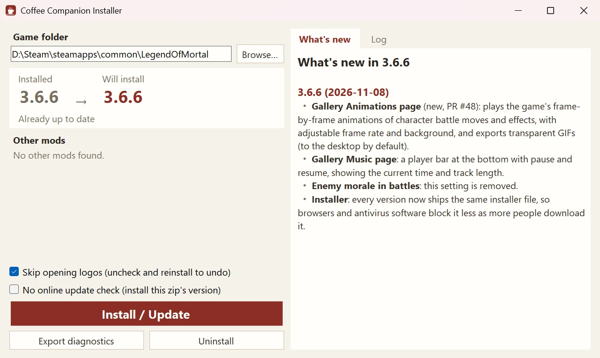

**Manual**: in Steam, right-click *Legend of Mortal* → Manage → Browse local files, and extract everything in the zip into the game folder, overwriting files. Remove older mods of the same kind (骰子大师, 多功能 Mod, 赵活系统) from `BepInEx\plugins` first.

**Uninstall**: run the installer and click **Uninstall**. Saves are not touched.

## Hotkeys

| Key | Action |
|---|---|
| Tab | The Coffee Companion window (now, route map, story map, branch saves, save-anywhere, collection, stats, AI companion, settings) |
| F3 | AI companion tab |
| F8 | Settings; on the save screen, edit the note of the selected save |
| F9 | Stats page |
| F10 | Memo window |
| F5 / F7 / F6 | Save-anywhere: new save / load the latest / list all |
| F2 | Skip read dialogue until an unread line |
| F4 | Roll back to before the last story check |
| Right click | Hide the UI to view CGs |
| Gamepad L3 | Open / close the window |
| ESC | The game menu gets **Skip turn**, **Win now** and **Export diagnostics** |

All keys can be changed or unbound under **Hotkeys** on the settings page.

## Settings

Everything is on the settings page of the window (F8), where settings can be searched by name. Changes are saved immediately; ones that need a restart are marked; hover over a name for details. Settings are also stored in `BepInEx\config\LOMAssistant.cfg`.

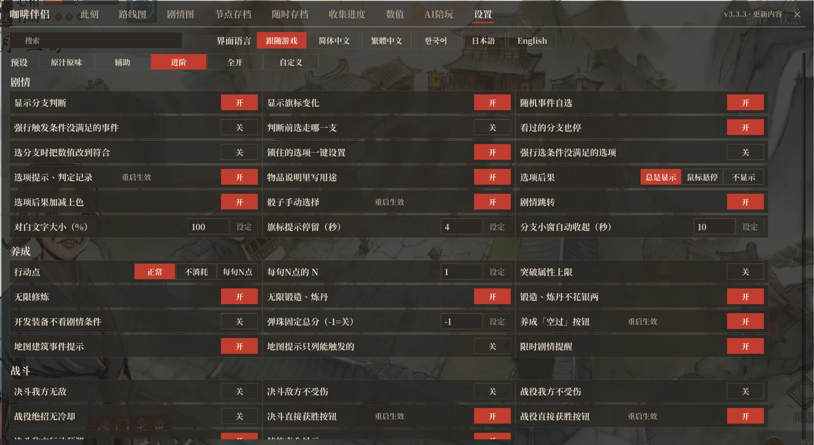

**Presets**: at the top of the settings page you can switch in one click to **As intended**, **Assist**, **Advanced** or **All on**. They only change story hints, training and combat aids and cheats; saves, speed-ups, interface and hotkeys stay as they are. Changing any of those switches makes it **Custom**; you can still switch back to a preset afterwards. New players pick one the first time they open the window; if they don't, it stays on **Assist**.

| Preset | Turned on |
|---|---|
| As intended | Everything listed below is off |
| Assist | Option hints; Option results; One-click unlock; Pick dice results; Map building hints; Timed story reminder; Skip turn button; Win-duel button; Win-battle button; Death-on-defeat notice; Duel round events; Lecture Hall unlock; Better battle controls; Unlimited training; Unlimited forging; Free forging |
| Advanced | Everything in Assist, plus: Show branch checks; Show flag changes; Pick random events; Show item uses; Read marks on choices; Story jump; Choose battle allies |
| All on | Everything in Advanced, plus: Manual branch choice; Force locked events; Force locked options; 4th Brother sells all; Gear dev: no story req; Enemy move forecast; full Lecture Hall unlock display |

Anything not listed does not change with presets and can be switched on its own in Settings.

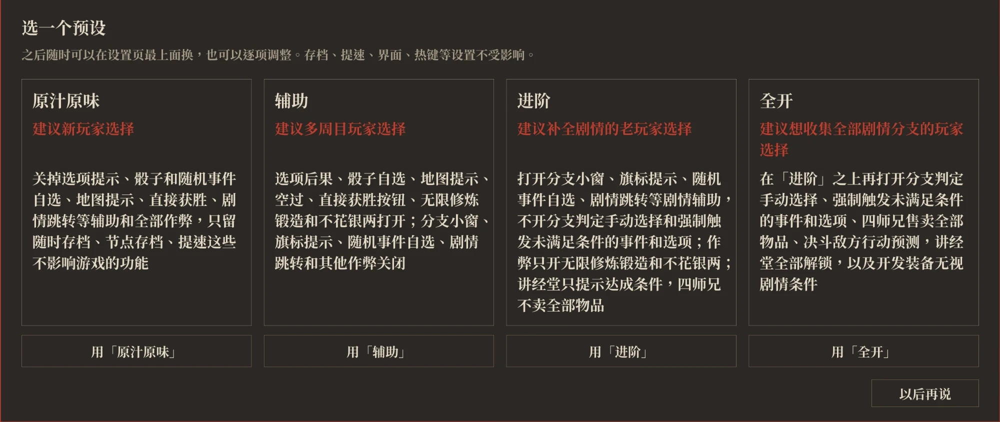

## Features

Setting names below are written as they appear on the settings page. The preset table above shows which preset turns on each feature.

### AI companion (F3)

Connect a large language model with your own API key to ask about the story and strategy, or to chat with characters from the game. Supports DeepSeek, Kimi, Qwen, Zhipu GLM, SiliconFlow, OpenRouter, OpenAI, Claude, Gemini, local Ollama, and any OpenAI-compatible endpoint.

- **Guide**: looks up the game's own story data before answering: quests and their triggers, script branches and dialogue, affection and stat totals along each route, endings and deaths, romance routes, character bios, location events, duel conditions, plus your current progress and the options on screen.
- **Heroines and the Eldest Brother**: the nine romanceable heroines and Tang Buyi, the Eldest Brother, speak in their own voice, their portraits change expression with what they say, and how they address you follows the story. They only know the story you have read. When you ask for help, a separate guide tip follows the reply; you can also set them to chat only.
- **Spoilers**: Tell me anything / Only current and past / Hints only.
- **Answers**: Fast / Standard / Deep. Fast looks things up less and answers faster but more roughly; Deep switches to a stronger model that checks the facts before answering: more accurate, but costlier and slower.
- **Edits**: when the AI wants to change stats, affection, your love interest, story flags or this mod's settings, it shows a card first; nothing changes until you confirm.
- **Chats**: each character's chats are stored locally; start new ones, switch between them, delete them, or export them to the desktop. Replies appear as they are written.
- **Proactive companion**: a persona of your choice stays on the game screen and says a line or two when you make a choice, roll the dice, finish a fight, gain or lose affection, or a timed event is about to expire. It only comments and advises. There are three levels of talkativeness (Quiet, Normal, Chatty), an optional separate model and a token cap per game launch. The figure can be dragged, shrunk or paused, and clicking its bubble takes you to the AI companion tab to follow up.
- **Custom personas**: put a persona text and images in a folder to add a persona of your own, available both on the AI companion tab and as the proactive companion. You can also replace the images and persona text of the built-in ones. Open the folder from AI settings; a readme inside explains how.
- **Cost and privacy**: you pay the provider's own rates; the mod charges nothing. Your key and chats go only to the provider you choose, and diagnostics exports do not contain the key.


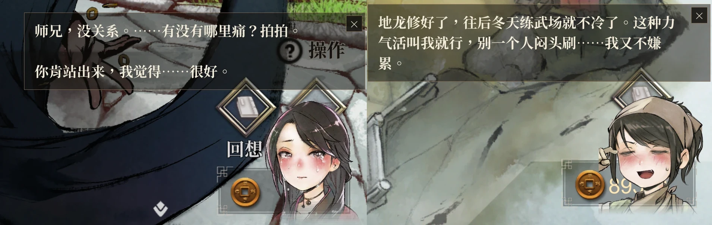

### Story overview (Tab)

- **Now**: the current scene, your location and your quests.
  - Scene: every option and dice outcome with its result, the branch conditions, and whether the following dialogue has been read.
  - Location: the random events here with their odds and which you have not seen; you can pick the next one to trigger.
  - Quests: your current quests, where to trigger them and what is still missing.
  - Fights: what follows a win or a loss and the round events; battles also show the victory condition and battle events.

  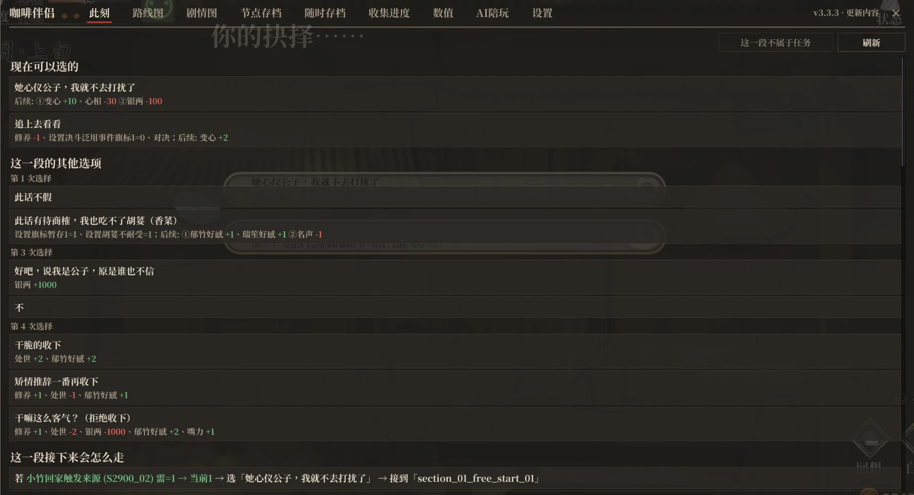

- **Route map**: the whole main story laid out as one line along the calendar, with side quests below.
  - Branches split off above and below the main line and come back to it where they rejoin, with the trigger condition on each split; where several routes run side by side, each keeps its own lane.
  - Ticks mark what this playthrough has done, the red 「今」 seal marks the current main quest and the next stop has a gold ring; **Back to now** jumps back to the current stop.
  - Click a stop to see where it leads next (when, where, conditions), its trigger conditions, its branches and its options; options are folded by default, and unfolding them shows each option's conditions and results. A side quest step shows the next step and which main stop it rejoins.
  - Search by quest, place, dialogue or flag; typing the first letters of the words, or Chinese pinyin initials, works too. A flag result lists the scenes that change or check it.

  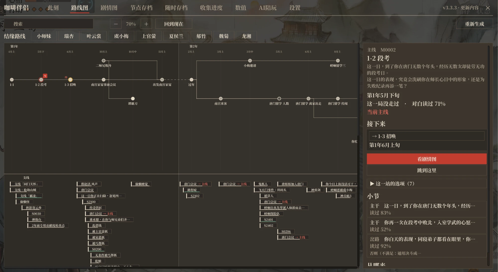

- **Romance routes**: pick a love interest on the route map to light up only her scenes and see each step, whether it is done and where to get it.

- **Story map**: each quest as a flow chart. Every scene box lists its ways on (options, dice, conditions) one per row, with a line from that row to the scene it leads to; options that stay in the scene are listed too. Hover over a row for the full condition and what it changes. Stories at places such as daily life in Kongtong and Qingcheng or Jiangling have story maps too, view-only.

  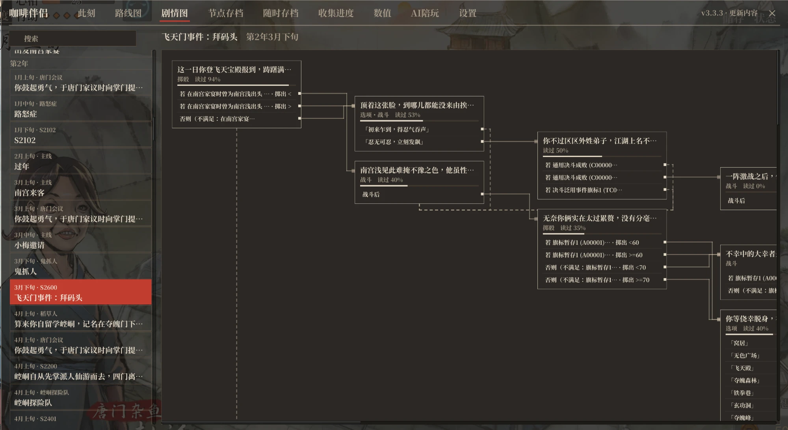

- **Branch saves**: progress is recorded when the game autosaves at story save points and at the start of each period; click **Replay from here** to go back and try another path. Separate per save, uses no save slots, synced with Steam Cloud.

  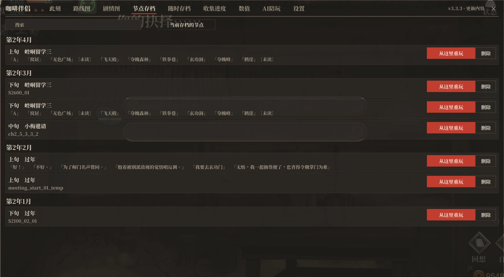

- **Story jump**: pick a scene on the route map or story map and click **Jump here** to play from there, even one you haven't reached yet.
  - Before the jump you see the choices along the way that affect what comes later; the progress in between is filled in the way you pick, and you can bond with one of the heroines too.
  - Condition checks inside the target scene default to the branch with unread lines; after the jump that branch is taken directly without changing values. With **Auto-adjust for branches** on, its conditions are filled in first, and the branch is taken directly when they can't be.
  - A save-anywhere save is made first, so you can always go back.
  - The story in between isn't actually played, so now and then things may not line up; not recommended for normal play.

  

- **Collection**: records from all playthroughs, split into story, heroine routes, endings, deaths, achievements and ending CGs.
  - Story counts how much of each quest's dialogue you have read; endings, deaths, achievements and ending CGs show their gallery numbers and whether you have them. For anything missing it says where and how to get it.
  - Heroine routes counts, for each character you can bond with, how much of her route's dialogue you have read and her endings; expand one to see it by quest.
  - Each entry lists the quests that lead to it; click one to open that quest's story map.
  - On the ending CG page, **Watch the credits** replays the end credits in a story scene; press Esc to stop.

  

### Story helpers

- **Pick dice results**: click a line on the dice wheel to choose that result.
- **Option results**: dialogue options and dice lines show what they will change.
  - Locked options show their real unlock conditions, and **Unlock** next to them sets the conditions.
  - With **Force locked options** on, options that are hidden when their conditions aren't met are listed too, marked **Conditions not met** in red; hover over one to see its conditions. Locked options whose conditions can't be set get **Force unlock**, which unlocks them without changing flags.
  - **Option results** in settings shows these always, only when you hover over an option, or never.

  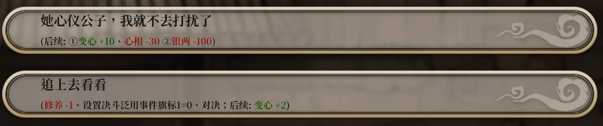

- **Read marks on choices**: dialogue options and dice lines show whether the lines that follow have been read (not seen, partly seen, seen).
- **Pick random events**: when working, wandering and so on, see each event's odds and changes, then choose which one triggers or roll with the normal odds.
  - Changes that depend on a condition show the condition; events you haven't seen yet are marked **Not seen**.
  - Branch checks that roll a random number also let you pick the path.
  - Each event or path can be set to **Always** or **Never**; the rule is remembered and applies even with the picker off.
  - With **Force locked events** on, events whose conditions aren't met are also listed below with what they need; clicking one triggers it regardless, without changing flags.

  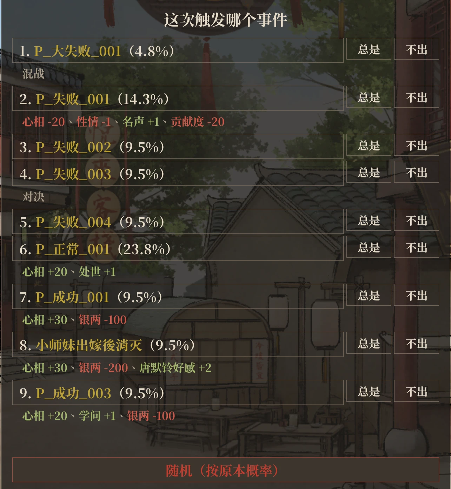

- **Manual branch choice**: at a story check that branches on conditions, the game stops first when another branch has unread lines or leads to a different scene. It lists each branch's conditions, current values and whether its lines were seen, and takes the branch you pick.
  - By default values are left alone and only this one check goes that way. With **Auto-adjust for branches** on, stats, affection and flags are first changed just enough for that branch (the changes stay), and the branch is taken directly when they can't be.
  - Checks with only one possible branch, or where other branches add nothing new, don't stop. With **Stop for seen branches too** on, it also stops when another branch has lines you've already seen.
  - Fast-forward is stopped when it pops up.
- **Map building hints**: hover over a building on the training map to see its main and side quests (can they trigger, conditions) and the odds of its random events; buildings with a quest you can trigger now stay lit.
  - Turn on **Map: triggerable only** to list only the quests that would trigger now; the rest are only counted.
  - Inside a building, hover over an option such as chopping wood or training to see the random events it can roll, their odds and which you have not seen; the same goes for moving and peddling in the Go out list.
- **Timed story reminder**: when a story whose conditions are met but hasn't triggered yet has 3 periods or fewer left in its window, the top left of the training map shows how many periods are left, until when, and where to go to trigger it; the Now tab marks these quests too.
- **Memos** (F10): a small window floating over the game that keeps track of "get this done by that date".
  - Search for a condition among stats, affection, talents, facilities, items, flags, and the layers and progress of martial arts, forging and alchemy, then set a target and a deadline.
  - The window shows the current value, progress and periods left, and notes at its top when a goal is met, stops being met, is about to be due or is overdue.
  - It can be dragged, resized and collapsed.
- **Show item uses** (may reveal quest names): item descriptions in the bag and shops end with what using the item does and which stories check for it or take it.
- **Show branch checks** (spoilers): lists the conditions of each branch check, in a panel on the left or as a notice at the top of the screen, met in green and unmet in red.

  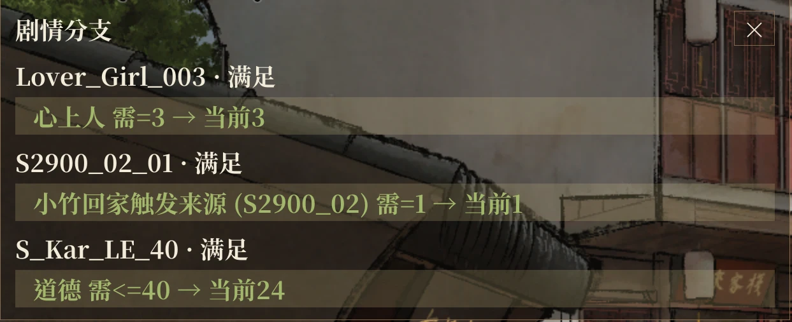

- **Show flag changes** (spoilers): a notice at the top of the screen when the story changes a flag; how long it stays and its text size can be set.
- **Check log**: story checks, their conditions and your values are recorded in the backlog.
- **Hide UI for CGs**: right-click in a story scene to leave only the background, CG and portraits; right-click, left-click or press any other key to restore.

### Saves

- **Save anywhere**: save during dialogue, options, dice rolls or on the training map, without using the game's slots; not available in combat.
  - F5 saves, F7 loads the latest, F6 opens the list.
  - In the list you can write notes, see the dialogue at that point, group saves by save slot, save time or game date, filter them and delete a whole group.
  - No limit by default; set one in Settings.
  - Loading hides the fast-forward, shows progress and mutes the sound.

  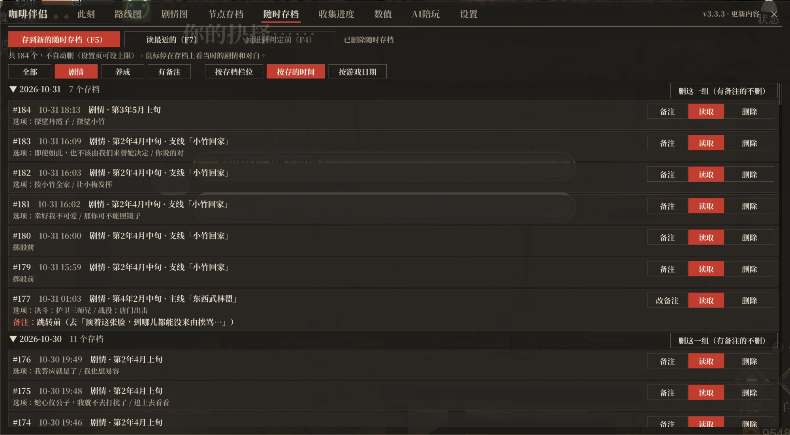

- **Roll back** (F4): story checks and branch choice boxes are saved temporarily; press F4 to return to the line before and check or choose again.
- **New save/load screen**: you can switch back to the original.
  - The list shows your love interest's portrait, date and note; the detail pane shows her full portrait (a shy expression once you have bonded with her in that save) and the first lines after loading.
  - Manual and auto saves are on separate pages; the screen opens on the save you made last.
  - A switch at the top right of the load page lists them by slot or newest first; with newest first, the save page starts with an empty slot.

  

- **More slots**: 100 manual saves (20 in the base game), 5 pages of legend slots (1 page of 12), and 5 extra old copies of each auto save; all of these numbers can be changed in Settings.
- **Save notes**: on the save screen, select a manual save and press F8 to write a note. Notes are synced with Steam Cloud, and notes from LOM_SaveSlotExpander and LOM_SaveSlotMemo are imported.

### Training

- **Action points**: normal / not consumed / N per period.
  > ⚠️ The last two can make some story events not trigger or trigger early, and may block key main quests. Use with care and keep saves.
- **Unlimited training and forging**: training, forging and alchemy use up no attempts or points; **Free forging**, which removes the silver cost of forging and alchemy, is a separate switch.
- **Break stat cap**: stats that normally cap at 100 can go up to 9999.
- **Gear dev: no story req**: the forge and alchemy room can develop new gear and medicines before the story that unlocks them; level and sect size requirements still apply.
- **Swap development items**: the forge and alchemy room development screens also list other branches of the same type, so you can swap without going back to the default item when your item level and sect size are high enough.
- **Pinball score**: when you leave the pinball minigame, the total score is set to the value in this setting.
- **4th Brother sells all**: the fourth senior brother's shop sells every book, sundry and special item (except 《证类本草》).
- **Skip turn**: in the ESC menu on the training and study maps; uses one action without triggering events. A key can also be bound to it under **Hotkeys**.

### Combat

- **Duel backlog**: press L or click the backlog button above the fast-forward button during a duel to read back the taunts, character dialogue and narration shown in the current duel, in order. The duel pauses while you read, and the backlog is cleared when you leave the duel.
- **Stronger duel enemies**: raises enemy health and stats at the start of a duel based on the total of your six main stats; strong enemies stay clearly stronger than ordinary ones. Enemies also choose moves based on both sides' stamina and health and on the move you keep repeating.
- **Enemy move forecast**: shows the enemy's chosen move; the window can be moved and resized.
- **Death-on-defeat notice** (spoilers): when losing a fight leads to a death, the top of the screen shows its name and whether you have collected it for the whole fight. If other conditions also apply after the loss, it says the loss may mean death; deaths caused by options are not shown.
- **Duel round events** (spoilers): when reaching a round in a duel ends the fight or changes a flag, the top of the screen shows the next such round.
- **Better battle controls**:
  - Fixes direction keys not responding after a stun.
  - Normal attacks turn to the nearest enemy and reach further, with a ring at your feet showing their range.
  - Thrown knives aim at the nearest enemy and charged throws no longer miss.
  - Your own ultimate covers a larger area, and drops are picked up from further away.
  - Weapons, traps and poison clouds from your side no longer hurt you.
- **Choose battle allies**: the ultimate list on the battle start panel also offers allies with affection of 40 or more, not only those the story names.
- **Win now**: in the ESC menu during duels and battles.
- **Show all skills**: in battle, a long skill list is split into columns.
- **Combat cheats**: four switches, **Invincible in duels**, **Enemy unhurt in duels**, **Unhurt in battles** and **No ultimate cooldown**; no preset turns them on.

### Stats page (F9)

Stats, martial arts, sects, relationships (everyone), talents, training and crafting points, facilities, books, items and flags on one page; add, subtract or set any value, and search by name, ID, description, the first letters of the words or Chinese pinyin initials.

- **Books and items**: set the count directly; quests advance as if bought in a shop. Hover over a martial manual to see what each layer adds when learned; learned layers are ticked.
- **Stats**: can be set below the bonus from manuals and the like, even below zero, and stay there through later story changes and loading.
- **Love interest and titles**: your love interest is shown by name; mood, the four personality stats and yin-yang show their current title after the value. Pick any title or write your own.
- **Locks**: mood, the four personality stats, yin-yang, silver and contribution each have a lock that keeps story and options from changing them; locks stay on across restarts and saves.
- **Flags**: over a thousand, grouped by sect favour, characters, story and more.
- **Reverse lookup**: click a flag, book or item to list the scenes that change or check it; click a name under relationships to list the scenes that check it. Each links to the story map.
- **Stat presets**: values you change on the Stats page are recorded; click **Stat presets** to save them as a preset. After loading another save or starting a new game, click **Apply** to set them all at once; values you didn't change are left alone.

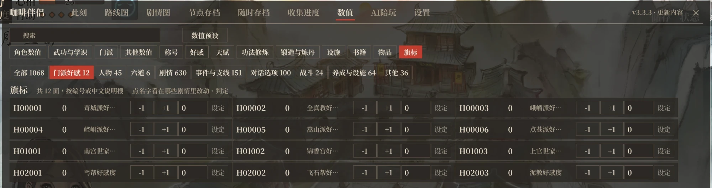

Changing values or flags at random can break the story; save first.

### Speed-ups

- **Game speed**: 1x / 2x / 3x / 5x. Battles and lines that advance by themselves stay at normal speed; turn on **Speed up battles too** to speed up battles as well.
- **Skip read dialogue** (F2): press once in a story scene to keep skipping dialogue you have read, and press again to stop; it stops by itself at unread dialogue.
- **Faster flow**: faster scene changes, loading and skipping, shorter pauses after stat changes, no idle wait between duel rounds.
- **Faster startup**: the title animation is sped up, and the installer can skip the opening logos.

### Title screen

The title screen gets two more buttons, **Training Pagoda** and **Gallery**.

- **Training Pagoda**: plays the demo's Training Pagoda mode, including the deaths only this mode can trigger.
- **Gallery**: has CG, Portraits, Animations, Duels and Music pages and supports gamepads.
  - CG: CGs appear once you have seen them; all scene images are open, and a switch on the page shows locked content.
  - Portraits: pick a background, place characters and change variants, then hide the UI for screenshots.
  - Animations: plays frame-by-frame animations of character battle moves and effects and exports transparent GIFs.
  - Duels: every duel character's battle portraits (normal, attack, hurt, block), with zoom and drag, exported as transparent PNGs.
  - Music: all 39 official soundtrack tracks, with pause and playback progress.
- **Title screen partner**: choose which character appears on the title screen, or show everyone or nobody.

### Interface and other

- **Interface**: window colours can be light, dark or follow the system; Source Han Serif or Microsoft YaHei font; separate opacity for the main window, small windows and hint boxes; larger game text and dialogue text.
- **Gamepad**: the whole window works with a gamepad (L3 opens it, the left stick moves the pointer, A clicks, LB / RB switch tabs); dice, skip turn and the event picker too.
- **Languages**: Simplified Chinese, Traditional Chinese and Korean following the game language, Japanese with the [Japanese patch](https://dlaqe2334.github.io/LOM-JPMOD/), English with an English patch; can also be chosen in settings.
- **Lecture Hall**: hover over an ending or death entry to see how to reach it; everything can also be shown as unlocked.
- **Export legend**: export this playthrough's legend as a txt at any time from Status → Legend.
- **Run in background**: the game keeps running when you switch to another window.
- **Export diagnostics**: ESC → Settings → **Export diagnostics** packs logs and settings to the desktop (no saves); also in the installer.
- **Conflict detection**: warns about conflicting old mods at the top of settings (mods that only change the same game code alongside this one and work with it aren't flagged); if another mod uses the same key, this mod gives it up.
- **Update notice**: the window's top right shows each version's changes and a red note when a new version is out.

## FAQ

**Found a bug?** Run the installer again to make sure you are on the latest version. If it persists, export diagnostics and open an [issue](https://github.com/kevinnie2003/LOMAssistant/issues) describing how it happened.

**Nothing happens after installing?** Quit Steam completely from the tray and start the game again. If it still does not work, use **Export diagnostics** in the installer.

**Game in a folder with Chinese or other non-English characters?** BepInEx fails to load there. Move the game folder to a path with only English letters and numbers (in Steam, right-click the game → Properties → Installed Files → Move install folder), then run the installer again.

**Option results missing, dice cannot be picked?** An older mod of the same kind is installed. The installer handles this; for manual installs, remove the old mods from `BepInEx\plugins`.

**Works with other mods?** Yes, mods whose features don't overlap can be installed alongside it. If a hotkey clashes, this mod gives way automatically, and you can bind another key under Settings > Hotkeys. If another mod ships its own BepInEx, run this mod's installer again after installing it. Story mods loaded with Binarizer also work: the Story map and Gallery read the mod's scripts, and save-anywhere can save and load inside them. Checks written directly in a mod's scripts aren't shown, and after installing a mod, older save-anywhere saves that passed through scripts it changed can't be loaded.

**Linux / Steam Deck?** Install manually and add `WINEDLLOVERRIDES="winhttp=n,b" %command%` to the Steam launch options.

## Building

You need the .NET 8 SDK and a game folder with the mod installed (the build references the game's and BepInEx's assemblies; no game files are in this repository).

```bash
GAME="D:/Steam/steamapps/common/LegendOfMortal" DOTNET=/path/to/dotnet ./build.sh
DOTNET=/path/to/dotnet ./Installer/build-installer.sh
```

## License

[MIT](LICENSE)

## Code signing policy

Free code signing provided by [SignPath.io](https://about.signpath.io/), certificate by [SignPath Foundation](https://signpath.org/).

The installer (`咖啡伴侣安装器 Installer.exe`) is built from this repository's source by GitHub Actions and then signed. The maintainer approves every signing request by hand.

- Author and reviewer: [kevinnie2003](https://github.com/kevinnie2003); pull requests from others are reviewed by the author before merging
- Signing approver: [kevinnie2003](https://github.com/kevinnie2003)

**Privacy**: this program will not transfer any information to other networked systems except in the cases below, which the user turns on or asks for.

- When opened, the installer reads the latest version and release notes from GitHub, and downloads the new zip when you click Install. With "No online update check (install this zip's version)" ticked, it does not go online.
- After the game starts, the mod reads the latest version number from GitHub. Turning off the "Check for updates" setting keeps it offline.
- When you ask something, the AI Companion sends your question and the related game information to the AI provider you set up; once you turn on "Proactive companion", it sends the recent dialogue and events to the same provider before each remark.

## Credits

See the [Chinese README](README.md#致谢). This project builds on 活侠传助手 by 爱死 and takes ideas from 赵活系统. The AI Companion tab takes ideas from [江湖夜话](https://github.com/Cpjjason/jianghu-yehua) (Jianghu Yehua) by Cpjjason, another AI mod for the game that lets you chat privately with its characters, who can give you items, teach you martial arts and remember past talks ([video on Bilibili](https://www.bilibili.com/video/BV1s2nC6pE83/)). Some personality traits and habits of the characters on the AI Companion tab draw on the 活侠传 fan character card by 夏呆呆 from the 类脑 community. Thanks to [lxsb222-spec](https://github.com/lxsb222-spec), [blakceyes](https://github.com/blakceyes), [NEXTAltair](https://github.com/NEXTAltair), [pluvivanto](https://github.com/pluvivanto), [lockpick](https://github.com/lockpick) and [F1-ZX](https://github.com/F1-ZX) for their pull requests, and to [mahosalieri85-a11y](https://github.com/mahosalieri85-a11y) and [iampigcheng](https://github.com/iampigcheng) for their issues.
