# 커피 동반자

[简体中文](README.md) · [繁體中文](README.zh-Hant.md) · [English](README.en.md) · [日本語](README.ja.md) · **한국어**

『활협전』(Legend of Mortal)용 BepInEx 6 플러그인입니다. 이름 「咖啡伴侣」(커피 친구)는 플레이어들이 서행(瑞杏)에게 붙인 별명 「咖啡」(커피)에서 왔습니다. 瑞杏의 중국어 발음이 중국 커피 체인 「瑞幸(Luckin Coffee)」과 같기 때문입니다. 최신 버전 게임을 지원하며, AI 동행, 스토리 전체 보기, 분기 선택, 수치 편집, 저장 개선 등을 추가합니다.

게임 언어를 한국어로 설정하면 이 Mod의 창과 알림도 한국어로 표시됩니다(설정 탭 맨 위 「표시 언어」에서 직접 고를 수도 있습니다). 지금은 자주 쓰는 화면 문구만 번역되어 있고 나머지는 중국어로 나옵니다. 번역이 정확하지 않을 수 있으니, 어색한 번역을 발견하면 [Issues](https://github.com/kevinnie2003/LOMAssistant/issues)로 알려 주세요. 아래 스크린샷은 중국어 화면입니다.

 [![Nexus Mods](https://img.shields.io/badge/Nexus%20Mods-%EB%8B%A4%EC%9A%B4%EB%A1%9C%EB%93%9C-D98F40?style=for-the-badge&labelColor=8A5A28&logo=data%3Aimage%2Fpng%3Bbase64%2CiVBORw0KGgoAAAANSUhEUgAAACAAAAAgCAYAAABzenr0AAAEXElEQVR4AazW7XkTOxAF4E0auaYSQiVAJQmVECrBVEJuJeG8Y42stR3yBz%2BalTQfZ45GWq3vt3%2F8e319PUQeI7%2BH%2FEz%2F8FaamwQSAOQh%2FVUgXUSC7%2BmBt5g%2FJtHvyFPkMARG%2B9BFfW47AgGU%2BGfMQPQCrUQvwWts9BJ8yRh4izl91LO9zNG28YNz2JbfJCB59BJzzHA2AXQSTOU7g6e70%2B9D%2FL5GmggsJOBFvW2TQGbfI90EHDN5jujTVWu9lX6KZhU69k%2FJ%2FS22ahnD4KenQ2LmKgJZPUWzKhCeCcaeCJYAEEKqYStWYf%2BaGHbhU6KDiRQceltd%2Be6T3AAgAwEi4GXYJBHMZosksgrzVcRdJQ%2BGZBYIZ42rsQp8XlBWEEkFqkAnXlx3w2NW2aubhiS3OIm32J2HH9M4BghwqmmcJkjGqmBeAOXw9gPZnXVJXrYx%2F7g4VbUQaJ2EPa4%2BJAQrec1vPBBcq1YuI1kTdzdYuWrOrQ525UOgBom0V9Mh82pxRMI21DwPSdNVO8S%2BzkuZh6Tpqtlr2wynFHnU6tPXa7ga3HAC2KaMJPYQkdX%2Fynesfm7rALlc2Iy7Dzg2vQqGLt2IPXXxe4k8R1Rs%2Bo%2BEJ6c8Y4fndc1s1%2F7LjC3dptpyVQUofnkMOQbU9Xu5imGuzp7WII86WIkBqoJ9Xce0a6pwVT1ngFeBGESAY%2BfuJ8ZRn9tYZa%2FmS5Kr2nuv6iVO5WwCZ%2FRtU%2BItPwFYu7v1UW1bktVKa3J68FurJR65v709IsXNLaBoKUNP0tc8iZXXKgnwy6R0vgMfUqFbZyBQu4boJFCTxWwFy3TzDktQZIZhF5Ok3yIzLmP77c2ZusSt8f9nPgnUhOIdkXT91Da4bVkrUjAh4c1RDeTFehPK1o8%2BA4yte8yggTOcTWLltbJWOrA9dtn0eNeHiBhE5lmKw%2FkQxkHCJqFMK3B8qz3lHLDVZDzEjeFWFYjPmmTrX3LAR6JV9ZevK9BKvSSqoGzmLb54QHruC2feJGyDOK%2FuzXtkkHCbwpDn80qAgqHF5dTgEnVg272SVts%2B9E0aFiII0a%2By%2Bj8UgYuyuWbtmZPfSX3xkJhAI4ZPJ522MUDCtu1IjCo01qEIJGA9nb%2BGEyJuOO%2F2yjru1XbApdk%2FJLGA2us2DeLIUT03AZOWj3GS%2BCFEnPqr5LFL3iAdt%2FZiHDhvhgOtUrZMTI2H849bBHzjrRrA8Dt3Se602%2Fuz8nR9W7HtEIeARdg6lWTjvyZ3qI9NAEsORMlWR7qSkRywMyKRErvt9BJZITsiYh4To1pW7wpHnr4vqNNNmFJjCISR%2BMJ5lWqlAelXDDg7gsZ6wMaSlj%2BHCDLm9BKbR11t5uoKeKetwGrKIw8BXiUJCKCo320WA%2BstR9tri8o%2BCZiNSiCxAiDC3IKIFRBjvnrAgbhzcNng9DaZOw93%2Bc3kAHcEKOJgfyogc%2BDpNquSBLivnr9mxBiwfgc8cI7p%2BZVsN35%2FAAAA%2F%2F8CpstnAAAABklEQVQDAC6567qqPgZJAAAAAElFTkSuQmCC)](https://www.nexusmods.com/legendofmortal/mods/10)

  

## 설치

압축 파일에 BepInEx가 들어 있습니다.

**설치 프로그램(추천)**: 압축을 풀고 `咖啡伴侣安装器 Installer.exe`를 실행한 뒤 「설치 / 업데이트」를 누르세요. 게임 폴더를 자동으로 찾아 최신 버전을 내려받고(GitHub에 연결되지 않으면 동봉된 버전을 설치), 충돌하는 옛 Mod는 `BepInEx\DisabledMods`로 옮깁니다(삭제하지 않음). 업데이트할 때는 다시 실행하면 됩니다. 설치 프로그램은 Windows 표시 언어에 맞춰 표시됩니다.

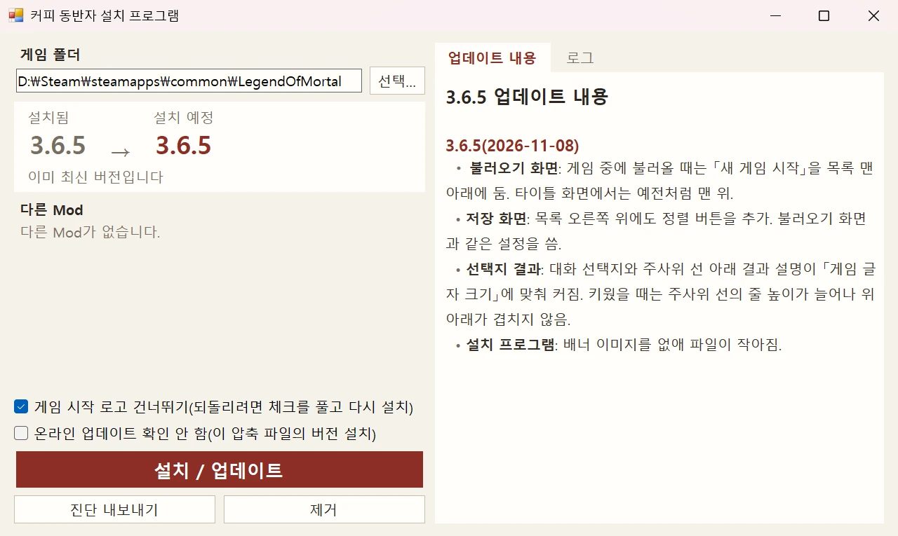

**수동 설치**: Steam에서 『활협전』을 우클릭 → 관리 → 로컬 파일 보기에서, 압축 파일의 내용을 모두 게임 폴더에 덮어쓰며 풀어 주세요. 먼저 `BepInEx\plugins`에서 같은 종류의 옛 Mod(骰子大师, 多功能 Mod, 赵活系统)를 지우세요.

**제거**: 설치 프로그램에서 「제거」를 누르세요. 저장 데이터에는 영향이 없습니다.

## 단축키

| 키 | 기능 |
|---|---|
| Tab | 커피 동반자 창(지금, 루트 맵, 스토리 맵, 분기 저장, 퀵세이브, 수집 현황, 수치, AI 동행, 설정) |
| F3 | AI 동행 탭 |
| F8 | 설정. 저장 화면에서는 고른 저장에 메모 쓰기 |
| F9 | 수치 탭 |
| F10 | 메모장 |
| F5 / F7 / F6 | 퀵세이브: 저장 / 최근 것 불러오기 / 목록 |
| F2 | 읽은 대사 빨리 넘기기. 안 읽은 대사에서 멈춤 |
| F4 | 판정 전으로 되돌리기 |
| 우클릭 | UI 숨기고 CG 보기 |
| 게임패드 L3 | 커피 동반자 창 열기/닫기 |
| ESC | 게임 메뉴에 「턴 넘기기」「즉시 승리」「진단 내보내기」 추가 |

키는 설정 탭 「단축키」에서 바꾸거나 해제할 수 있습니다.

## 설정

모든 설정은 창의 설정 탭(F8)에 있고, 이름으로 검색할 수 있습니다. 바꾸면 바로 저장됩니다. 재시작이 필요한 것은 표시되며, 이름에 마우스를 올리면 설명이 나옵니다. `BepInEx\config\LOMAssistant.cfg`에도 저장됩니다.

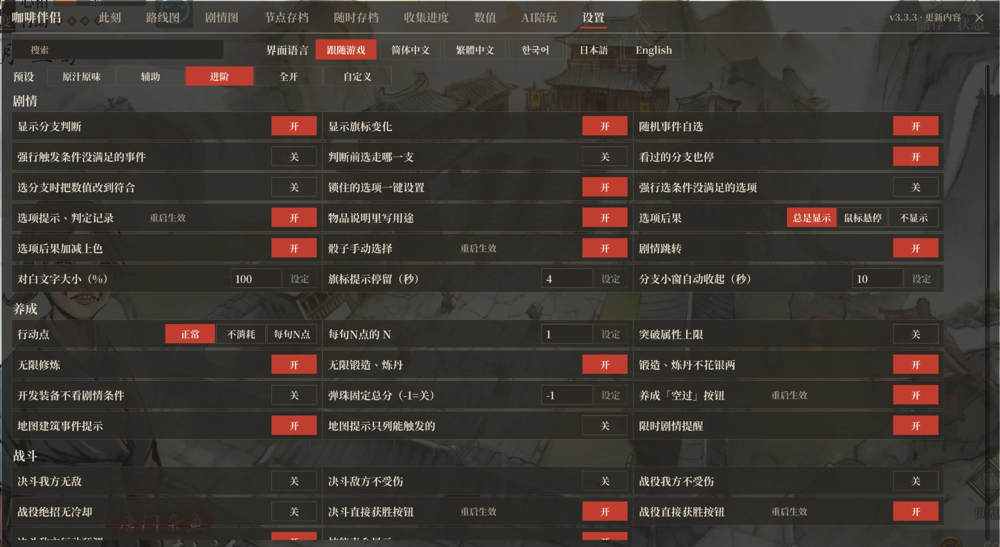

**프리셋**: 설정 탭 맨 위에서 「원작 그대로」「보조」「고급」「모두 켜기」로 한 번에 바꿀 수 있습니다. 바뀌는 것은 스토리 안내, 육성·전투 보조, 치트류 스위치뿐이고 저장·가속·화면·단축키는 그대로입니다. 하나라도 바꾸면 「사용자 지정」이 되며 나중에 되돌릴 수 있습니다. 새로 설치한 플레이어는 처음 창을 열 때 한 번 고릅니다. 고르지 않으면 「보조」 그대로입니다.

| 프리셋 | 켜지는 기능 |
|---|---|
| 원작 그대로 | 아래에 나열한 기능은 모두 꺼짐 |
| 보조 | 선택지 정보·판정 기록, 선택지 결과, 잠긴 선택지 조건 충족시키기, 주사위 직접 선택, 지도 건물 이벤트 안내, 기한 있는 스토리 알림, 육성 「턴 넘기기」 버튼, 결투 즉시 승리 버튼, 전역 즉시 승리 버튼, 전투 패배 사망 알림, 전투 회차 이벤트 알림, 강경당 해금 표시, 전역 조작감 개선, 무한 수련, 단조·연단 무제한, 단조·연단 은자 소모 없음 |
| 고급 | 「보조」의 전부에 더해: 분기 판정 표시, 플래그 변화 표시, 랜덤 이벤트 선택, 물품 설명에 용도 표시, 선택지·주사위 읽음 표시, 스토리 점프, 전역 지원 동료 선택 |
| 모두 켜기 | 「고급」의 전부에 더해: 판정 전에 분기 고르기, 조건 미충족 이벤트 강제 발생, 조건 미충족 선택지 강제 선택, 사사형 상점: 모든 아이템, 장비 개발 시 스토리 조건 무시, 결투 적 행동 예측, 강경당 전부 해금 표시 |

목록에 없는 기능은 프리셋으로 바뀌지 않으며 설정 탭에서 따로 켜고 끌 수 있습니다.

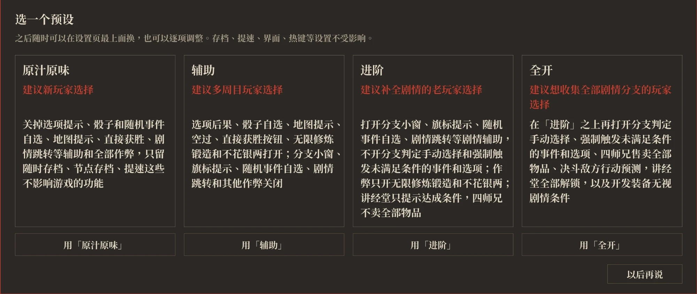

## 기능

아래에서 「」로 묶은 설정 이름은 설정 탭에 나오는 이름과 같습니다. 기능마다 어느 프리셋에서 켜지는지는 위의 프리셋 표에 있습니다.

### AI 동행 (F3)

자신의 API Key로 대규모 언어 모델에 연결해 스토리와 공략을 묻거나 게임 속 인물과 대화할 수 있습니다. DeepSeek, Kimi, 통이첸원(Qwen), 즈푸 GLM, SiliconFlow, OpenRouter, OpenAI, Claude, Gemini, 로컬 Ollama, 그리고 OpenAI 호환 API를 지원합니다.

- **공략 도우미**: 게임 안의 스토리 데이터를 먼저 찾아본 뒤 답합니다. 임무와 발생 조건, 대본 분기와 대사, 루트별 호감·수치 합계, 엔딩과 사망, 인연 루트, 인물지, 장소 이벤트, 결투 조건, 그리고 지금의 진행 상황과 화면의 선택지.
- **여주인공과 대사형**: 인연을 맺을 수 있는 아홉 여주인공과 대사형 당포의가 자기 말투로 말하고, 입식 그림 표정이 말에 따라 바뀌며, 부르는 호칭도 스토리에 따라 바뀝니다. 플레이어가 읽은 스토리만 압니다. 공략을 물으면 대답 뒤에 공략 힌트가 따로 붙고, 대화만 하도록 설정할 수도 있습니다.
- **스포일러 정도**: 묻는 대로 다 알려 줌 / 현재·지나온 것만 / 방향만 힌트.
- **답변 방식**: 빠르게, 표준, 심층 세 단계입니다. 「빠르게」는 자료를 덜 찾아봐서 답이 더 빠르고 더 대략적입니다. 「심층」은 더 강한 모델로 바꾸고 답하기 전에 자료를 다시 확인합니다. 더 정확하지만 더 비싸고 느립니다.
- **수치·설정 변경**: 수치, 호감, 마음에 둔 사람, 플래그, 이 Mod의 설정을 바꿀 때는 AI가 먼저 카드를 보여 주고, 확인을 눌러야 바뀝니다.
- **대화**: 대화는 상대별로 로컬에 저장되며 새로 열기, 전환, 삭제, 바탕 화면으로 내보내기가 됩니다. 대답은 쓰이는 대로 바로 표시됩니다.
- **동행의 한마디**: 고른 인물이 게임 화면에 머물며, 선택을 했을 때, 주사위를 굴렸을 때, 전투가 끝났을 때, 호감도가 변했을 때, 기한이 임박한 스토리가 있을 때 한두 마디를 하며, 평과 조언만 합니다. 말하는 빈도는 조용히, 보통, 수다 세 단계이며, 모델과 게임 실행 한 번당 token 상한을 따로 정할 수 있습니다. 모습은 끌어서 옮기거나 작게 줄이거나 말하기를 멈출 수 있고, 말풍선을 누르면 AI 동행 탭에서 이어서 물을 수 있습니다.
- **사용자 지정 인물**: 폴더에 인물 설정과 이미지를 넣으면 직접 만든 인물을 추가할 수 있고, AI 동행 탭과 동행의 한마디에서 모두 고를 수 있습니다. 기본 인물의 이미지와 인물 설정도 바꿀 수 있습니다. 「AI 설정」에서 폴더를 열면 안에 설명 파일이 있습니다.
- **요금과 개인정보**: 요금은 제공업체 가격대로 나가며 이 Mod는 무료입니다. Key와 대화는 고른 제공업체에만 보내지고, 내보낸 진단에는 Key가 들어 있지 않습니다.

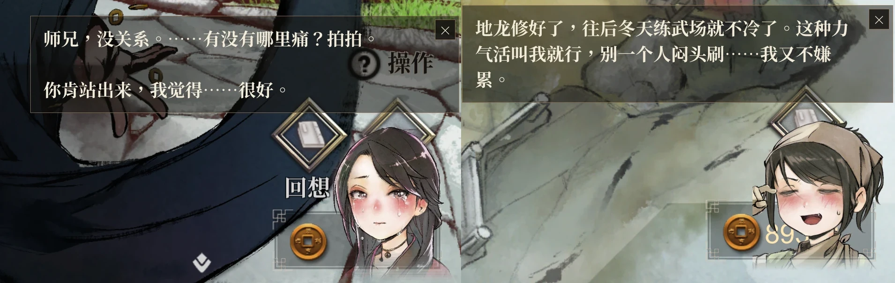

### 스토리 회고 (Tab)

- **지금**: 지금 장면, 현재 장소, 임무의 상황을 보여 줍니다.
  - 스토리: 지금 장면의 선택지·주사위 결과, 분기 조건, 이후 대사를 읽었는지.
  - 장소: 현재 장소의 랜덤 이벤트와 확률, 안 본 것(다음에 일어날 것을 고를 수 있음).
  - 임무: 진행 중인 메인·서브 퀘스트를 어디서 발생시키는지, 무엇이 부족한지.
  - 전투: 전투 중에는 승패 결과와 회차 이벤트를, 전역에서는 승리 조건과 전역 이벤트도 표시합니다.

  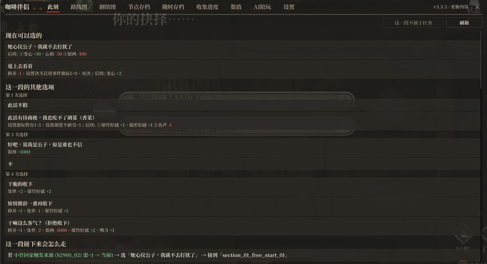

- **루트 맵**: 메인 스토리 전체를 달력 순서로 한 줄로 늘어놓고, 서브는 아래에 표시합니다.
  - 분기는 위아래로 갈라졌다가 합류하면 메인으로 돌아옵니다. 갈라지는 선에는 발생 조건을 적습니다. 여러 루트가 나란히 가는 곳은 각자 따로 한 줄을 써서 서로 얽히지 않습니다.
  - 체크는 이번 회차에 지나온 곳, 빨간 「今」은 지금 있는 메인 정거장, 다음 정거장은 금색 테두리로 표시하고, 「현재 위치로」를 누르면 그곳으로 돌아갑니다.
  - 정거장을 누르면 다음에 어디로 가는지(언제·어디서·조건), 발생 조건, 정거장 안의 분기, 이 단계의 선택지(기본은 접혀 있고, 펼치면 선택지마다 조건과 결과)를 볼 수 있습니다. 서브 임무는 다음 단계와 끝나면 어느 메인 정거장으로 이어지는지 보여 줍니다.
  - 임무 이름·장소·대사·플래그로 검색할 수 있고(초성이나 중국어 병음 첫 글자로도 검색 가능), 플래그는 어느 스토리에서 바뀌고 판정되는지 보여 줍니다.

  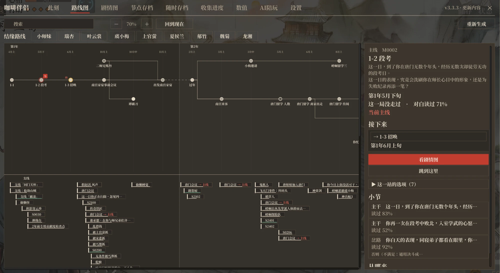

- **인연 루트**: 루트 맵에서 인연을 맺을 인물을 고르면 관련 스토리만 밝게 남고, 단계마다 이뤘는지와 얻는 곳을 보여 줍니다.

- **스토리 맵**: 임무 하나를 흐름도로 그립니다. 구간마다 상자 안에 갈 곳(선택지·주사위·조건)을 한 줄씩 늘어놓고, 그 줄에서 가는 구간으로 선을 잇습니다. 골라도 그 구간에 남는 선택지도 보여 줍니다. 줄에 마우스를 올리면 전체 조건과 변화를 볼 수 있습니다. 공동·청성에서의 일상, 강릉 같은 장소의 스토리도 흐름도로 볼 수 있습니다(보기만 가능).

  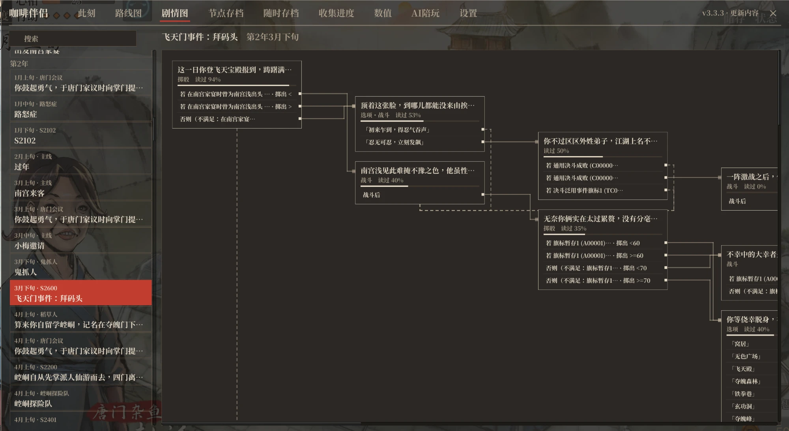

- **분기 저장**: 스토리 저장 지점과 각 순의 시작에 게임이 자동 저장할 때 함께 진행을 저장하고, 「여기서 다시 하기」로 돌아가 다른 길을 시험할 수 있습니다. 저장마다 따로 관리하며, 저장 슬롯을 쓰지 않고 Steam 클라우드로 동기화됩니다.

  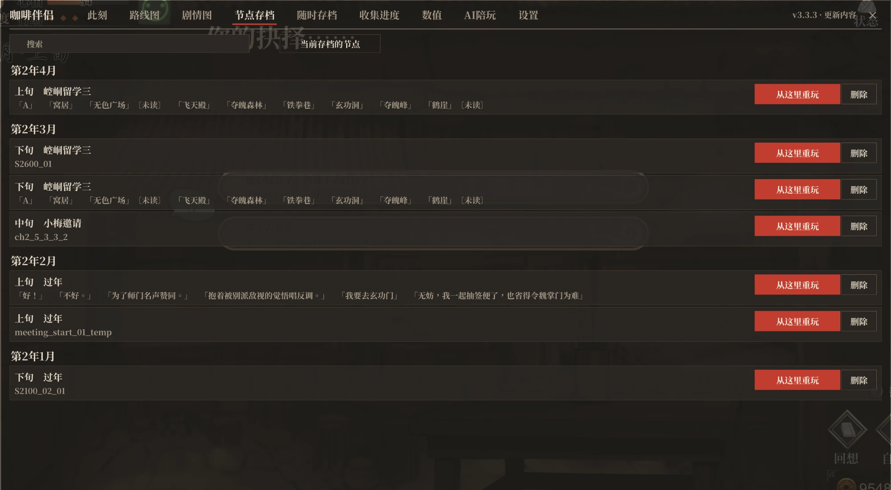

- **스토리 점프**: 루트 맵이나 스토리 맵에서 구간을 고르고 「여기로 점프」를 누르면 그 구간부터 바로 플레이할 수 있습니다. 아직 가지 않은 곳도 됩니다.
  - 점프하기 전에 이후 스토리에 영향을 주는 가는 길의 선택을 보여 주고, 고른 대로 중간 진행을 채웁니다. 여주인공 한 명과 인연을 맺을 수도 있습니다.
  - 목적지 구간 안에서 조건으로 갈리는 곳은 안 읽은 대사가 있는 쪽을 기본으로 고르고, 점프한 뒤 값은 그대로 두고 바로 그쪽으로 갑니다. 「분기를 고르면 값을 맞게 고치기」를 켜면 먼저 그 조건을 채우고, 채울 수 없으면 그대로 그쪽으로 갑니다.
  - 점프하기 전에 퀵세이브를 하나 자동으로 남기므로 언제든 돌아갈 수 있습니다.
  - 중간 스토리는 실제로 플레이한 것이 아니라서 가끔 이야기가 맞지 않을 수 있으니, 일반 플레이에는 권장하지 않습니다.

  

- **수집 현황**: 모든 회차의 기록. 스토리·엔딩·사망·업적·엔딩 CG로 나뉩니다.
  - 스토리는 임무마다 대사를 얼마나 읽었는지로 세고, 엔딩·사망·업적·엔딩 CG는 도감 번호와 달성 현황을 보여 줍니다. 아직 못 한 것은 어디서 어떻게 가는지 보여 줍니다.
  - 항목마다 그곳으로 가는 임무가 나오며, 누르면 그 임무의 스토리 맵이 열립니다.
  - 「엔딩 CG」 페이지의 「엔딩 크레딧 보기」로 스토리 장면 안에서 클리어할 때의 엔딩 크레딧을 다시 볼 수 있습니다(Esc로 종료).

  

### 스토리 보조

- **주사위 직접 선택**: 주사위 판정에서 선을 누르면 그 결과가 됩니다.
- **선택지 결과**: 대화 선택지와 주사위 선에 고르면 무엇이 바뀌는지 표시합니다.
  - 잠긴 선택지에는 실제 해금 조건을 보여 주고 「원클릭 해제」로 조건을 채울 수 있습니다.
  - 「조건 미충족 선택지 강제 선택」을 켜면 조건이 안 되면 나오지 않던 선택지도 빨간 「조건 미충족」 표시와 함께 보이고, 마우스를 올리면 조건이 나옵니다. 조건을 채울 수 없는 잠긴 선택지에는 「강제 해제」가 붙어 플래그를 바꾸지 않고 바로 풀 수 있습니다.
  - 설정의 「선택지 결과」에서 항상 표시 / 마우스를 올릴 때만 표시 / 표시 안 함을 고를 수 있습니다.

  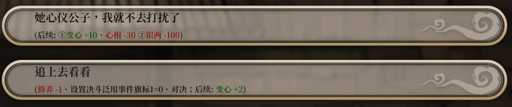

- **선택지·주사위 읽음 표시**: 대화 선택지와 주사위 선 뒤에 이어지는 대사를 읽었는지 표시합니다(아직 보지 않음·절반쯤 봄·봄).
- **랜덤 이벤트 선택**: 일·산책 등에서 일어날 수 있는 이벤트의 확률과 변화(조건에 따라 갈리는 변화는 조건과 함께)를 보고, 일어날 이벤트를 고르거나 원래 확률로 뽑습니다.
  - 아직 보지 않은 이벤트에는 「안 봄」이 표시됩니다.
  - 난수로 정해지는 분기도 길을 고를 수 있습니다.
  - 이벤트·길마다 「항상」「안 나옴」을 설정할 수 있고, 기억되어 이 기능을 꺼도 적용됩니다.
  - 설정에서 「조건 미충족 이벤트 강제 발생」을 켜면 등장 조건을 채우지 못한 이벤트도 아래에 접혀 있고, 필요한 조건이 적혀 있으며 누르면 조건을 무시하고 그대로 일어납니다. 플래그는 바꾸지 않습니다.

  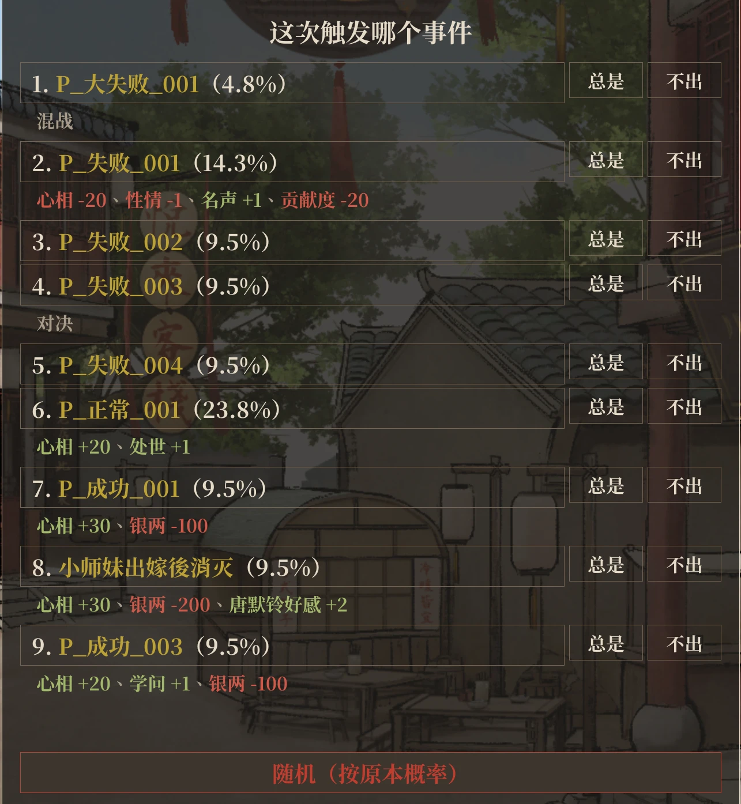

- **판정 전에 분기 고르기**: 조건으로 갈리는 스토리 판정에서 다른 분기에 안 읽은 대사가 있거나 다른 스토리로 이어지면 먼저 멈추고, 분기마다 조건·현재 값·대사를 봤는지 보여 준 뒤 고른 분기로 갑니다.
  - 기본으로는 값은 그대로 두고 이번 판정만 그 분기로 갑니다. 「분기를 고르면 값을 맞게 고치기」를 켜면 그 분기가 되도록 능력치·호감·플래그를 딱 맞게 고치고(고친 값은 남음), 고칠 수 없으면 그대로 그 분기로 갑니다.
  - 갈 수 있는 분기가 하나뿐이거나 다른 분기에 새 내용이 없는 판정에서는 멈추지 않습니다. 「본 분기도 멈춤」을 켜면 다른 분기에 대사가 있으면 이미 봤어도 멈춥니다.
  - 나타나면 빨리 감기를 멈춥니다.
- **지도 건물 이벤트 안내**: 육성 지도에서 건물에 마우스를 올리면 그곳의 메인·서브 퀘스트(발생 가능 여부, 조건)와 랜덤 이벤트 확률을 보여 줍니다. 지금 발생할 수 있고 아직 안 한 퀘스트가 있는 건물은 계속 빛납니다.
  - 설정에서 「지도 안내에 발생 가능한 임무만 표시」를 켜면 지금 들어가면 발생하는 것만 보여 주고, 나머지는 개수만 적습니다.
  - 건물에 들어간 뒤 땔감 준비, 수련 같은 선택지에 마우스를 올리면 그것을 골랐을 때 뽑히는 랜덤 이벤트와 확률, 안 본 것을 보여 줍니다. 외출 목록의 이동, 행상도 마찬가지입니다.
- **기한 있는 스토리 알림**: 조건은 이미 충족했지만 아직 발생하지 않은 스토리의 발생 기간이 3순 이내로 남으면, 육성 지도 왼쪽 위에 몇 순 남았는지, 언제까지인지, 어디로 가면 발생하는지 보여 줍니다. 「현재 상황」 탭의 임무에도 표시합니다.
- **메모장**(F10): 게임 화면 위에 떠 있는 작은 창으로, 「언제까지 무엇을 해 두기」를 적어 둡니다.
  - 수치·호감도·천부·시설·아이템·플래그, 무공·단조·연단의 단계와 진행도 가운데 조건을 검색해 고르고 목표값과 기한을 정합니다.
  - 지금 값·진행도·남은 순을 보여 주고, 달성했을 때, 다시 미달일 때, 기한이 다가오거나 지났을 때 창 위쪽에 알려 줍니다.
  - 끌어서 옮기고 크기를 바꾸고 접을 수 있습니다.
- **물품 설명에 용도 표시** (퀘스트 이름 스포일러 주의): 가방과 상점의 물품 설명 뒤에 사용 효과와, 그것을 확인하거나 가져가는 스토리를 보여 줍니다.
- **분기 판정 표시** (스포일러 주의): 분기 판정 때마다 화면 왼쪽 작은 창이나 화면 위쪽 알림으로 각 분기 조건을 표시합니다. 충족은 초록, 미충족은 빨강.

  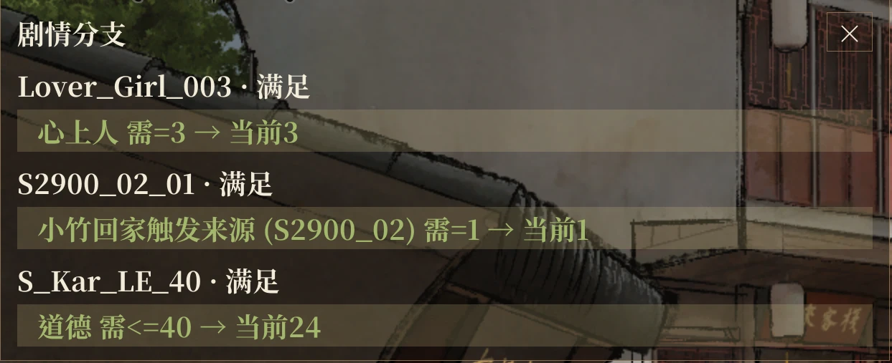

- **플래그 변화 표시** (스포일러 주의): 스토리가 플래그를 바꾸면 화면에 알림. 표시 시간과 글자 크기를 바꿀 수 있습니다.
- **판정 기록**: 지나간 판정·조건·당시 수치를 대화 기록에 남깁니다.
- **UI 숨기고 CG 보기**: 스토리 중 우클릭하면 배경·CG·초상화만 남습니다. 다시 우클릭하거나 좌클릭, 다른 키를 누르면 돌아옵니다.

### 저장

- **퀵세이브**: 대사·선택지·주사위 때와 육성 화면에서 저장할 수 있고, 게임 저장 슬롯을 쓰지 않습니다. 전투 중에는 불가.
  - F5 저장, F7 최근 것 불러오기, F6 목록.
  - 목록: 메모, 그때의 대사, 저장 슬롯·저장 시각·게임 날짜별 묶음, 필터, 묶음 삭제.
  - 기본은 개수 제한 없음, 설정에서 상한을 정할 수 있습니다.
  - 불러오는 동안 빨리 감기 화면을 가리고 진행도를 표시하며 소리를 끕니다.

  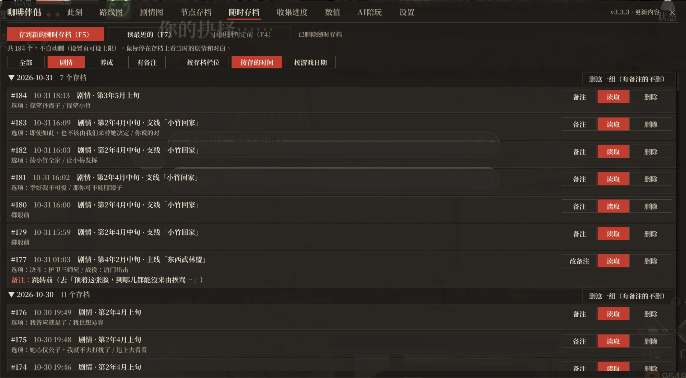

- **판정 전으로 되돌리기**(F4): 스토리의 판정이나 분기 선택 창에서 자동으로 임시 저장하고, F4로 그 앞 대사로 돌아가 다시 판정하거나 고를 수 있습니다.
- **새 저장·불러오기 화면**: 원래 화면으로 되돌릴 수 있음.
  - 연인 얼굴, 날짜, 메모가 있는 목록과, 연인 초상화(그 저장에서 이미 인연을 맺었으면 수줍은 표정)와 불러온 뒤 첫 대사를 보여 주는 상세 칸.
  - 수동 저장과 자동 저장은 다른 페이지. 열면 마지막으로 저장한 것을 고릅니다.
  - 불러오기 화면 오른쪽 위에서 슬롯 순과 최근 저장 순을 바꿀 수 있습니다. 최근 저장 순일 때는 저장 화면 맨 위에 빈 슬롯을 둡니다.

  

- **슬롯 추가**: 수동 저장 100칸(원래 20), 전기 슬롯 5페이지(원래 1페이지 12칸), 자동 저장은 종류마다 이전 기록 5개씩 보관. 개수는 모두 설정에서 바꿀 수 있습니다.
- **저장 메모**: 저장 화면에서 수동 저장을 고른 뒤 F8로 메모를 씁니다. Steam 클라우드로 동기화. LOM_SaveSlotExpander와 LOM_SaveSlotMemo의 메모도 가져옵니다.

### 육성

- **행동력**: 보통 / 소모 안 함 / 순마다 N회
  > ⚠️ 뒤의 두 가지는 스토리가 발생하지 않거나 앞당겨질 수 있고, 중요한 메인 퀘스트가 막힐 수도 있습니다. 자주 저장하세요.
- **무한 수련·단조·연단**: 수련·단조·연단에 횟수와 점수를 소모하지 않습니다. 「단조·연단 은자 소모 없음」은 따로 켜고 끄는 스위치입니다.
- **능력치 한계 돌파**: 원래 최대 100인 능력치의 한계를 9999로 올립니다.
- **장비 개발 시 스토리 조건 무시**: 단조장·연단실에서 해금 스토리 전에도 새 장비·약을 개발할 수 있습니다. 등급과 문파 규모 요구는 그대로
- **개발 항목 바로 교체**: 대장간·연단방의 개발 화면에 같은 종류의 다른 계열도 표시. 항목 레벨과 문파 규모가 충분하면 기본 항목으로 돌아가지 않고 바로 교체 가능
- **구슬치기 고정 총점**: 구슬치기 미니게임을 나갈 때 총점을 설정한 값으로 바꿉니다.
- **사사형 상점: 모든 아이템**: 사사형의 상점에서 서적, 잡물, 특수 아이템을 모두 팝니다(『증류본초』 제외).
- **턴 넘기기**: 육성 화면이나 유학 지도의 ESC 메뉴에서. 행동 1회를 쓰고 이벤트는 일어나지 않습니다. 「단축키」 그룹에서 키를 지정할 수도 있습니다.

### 전투

- **결투 적 강화**: 결투 시작 시 주인공의 6개 능력치 합계에 맞춰 적의 체력과 능력치를 높임. 강한 적은 일반 적보다 뚜렷하게 강한 상태로 유지됨. 적은 양쪽의 기력과 체력, 주인공이 반복하는 행동에 따라 행동을 고름
- **결투 적 행동 예측**: 적의 예정 행동 표시. 창은 이동·크기 조절 가능
- **전투 패배 사망 알림**(줄거리가 드러남): 전투에서 패배하면 생사부의 사망으로 이어질 때, 전투 내내 화면 위쪽에 사망 이름과 생사부 수록 여부를 표시. 패배 후 다른 조건도 따지는 경우 「사망할 수 있음」으로 표시하고, 선택지로 발생하는 사망은 표시하지 않음
- **전투 회차 이벤트 알림**(줄거리가 드러남): 결투에서 특정 회차가 되면 전투가 끝나거나 플래그가 바뀔 때, 다음 해당 회차를 화면 위쪽에 표시
- **전역 조작감 개선**:
  - 경직 뒤 방향키가 먹히지 않는 문제 수정.
  - 평타는 가장 가까운 적을 향해 나가고, 판정 범위가 넓어짐. 주인공 발밑에 평타 범위 표시.
  - 평사 암기는 가장 가까운 적을 조준하고, 모아 던지기가 빗나가지 않음.
  - 주인공의 절초 「분력일격」 범위 확대. 떨어진 물건을 줍는 범위도 넓어짐.
  - 주인공이 아군의 암기·함정·독안개에 피해를 입지 않음
- **전역 지원 동료 선택**: 전역 시작 화면의 절초 목록에 호감도 40 이상의 동료가 추가되어, 스토리가 지정한 동료로 제한되지 않음
- **즉시 승리**: 결투·전역 ESC 메뉴에서.
- **기술 목록 전체 표시**: 전투 중 아군 스킬 목록이 길면 여러 열로 나눕니다.
- **전투 치트**: 「결투 아군 무적」「결투 적 피해 없음」「전역 아군 피해 없음」「전역 절초 쿨타임 없음」 네 가지 스위치가 있으며, 어느 프리셋에서도 켜지지 않습니다.

### 수치 탭 (F9)

능력치, 무공, 문파, 호감(모든 인물), 천부, 수련·단조·연단 포인트, 시설, 서적, 아이템, 플래그를 한 페이지에서 늘리고 줄이거나 바로 설정할 수 있고, 이름·ID·설명·초성·중국어 병음 첫 글자로 검색할 수 있습니다.

- **서적·아이템**: 개수를 바로 설정. 상점에서 산 것처럼 퀘스트가 진행됩니다. 무공서 이름에 마우스를 올리면 등급마다 익혔을 때 오르는 능력치를 보여 주고, 익힌 등급에는 체크 표시가 붙습니다.
- **수치**는 비급 등의 보너스보다 낮게, 음수로도 설정할 수 있고, 이후 스토리의 증감과 불러오기에도 유지됩니다.
- **연인과 칭호**: 연인은 이름으로 표시. 심상, 네 가지 성격, 음양은 수치 뒤에 현재 칭호를 표시. 칭호는 모든 칭호에서 고르거나 직접 쓸 수 있습니다.
- **잠금**: 심상, 네 가지 성격, 음양, 은자, 공헌도에는 각각 잠금이 있어, 걸면 스토리와 선택지로 바뀌지 않으며, 재시작하거나 저장을 바꿔도 계속 잠겨 있습니다.
- **플래그**: 천 개가 넘는 플래그를 문파 호감·인물·육도·스토리 등으로 분류.
- **역추적**: 플래그·서적·아이템 이름을 누르면 어느 스토리에서 바뀌고 판정되는지 보여 줍니다. 호감의 인물 이름을 누르면 판정되는 곳을 보여 줍니다. 모두 스토리 맵으로 이동할 수 있습니다.
- **수치 프리셋**: 수치 탭에서 바꾼 항목을 기록하고, 「수치 프리셋」에서 프리셋으로 저장합니다. 다른 저장을 불러오거나 새 게임을 시작한 뒤 「적용」을 누르면 한 번에 저장한 값으로 바꿉니다. 바꾸지 않은 항목은 그대로 둡니다.

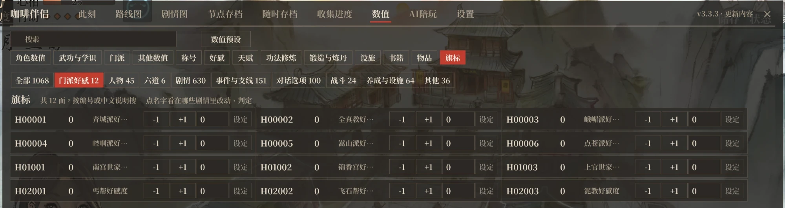

수치나 플래그를 함부로 바꾸면 스토리가 꼬일 수 있습니다. 먼저 저장하세요.

### 가속

- **게임 배속**: 1x / 2x / 3x / 5x(전역과 저절로 넘어가는 대사는 원래 속도. 설정에서 「전역에도 배속 적용」을 켜면 전역도 빨라짐)
- **읽은 대사 빨리 넘기기**(F2): 스토리에서 한 번 누르면 읽은 대사를 계속 넘기고, 다시 누르면 멈춥니다. 안 읽은 대사에서는 저절로 멈춥니다.
- **진행 가속**: 장면 전환, 불러오기, 빨리 넘기기가 빨라지고, 수치 변화 뒤 대기가 짧아지며 결투 턴 사이 대기도 없어집니다.
- **빠른 게임 시작**: 타이틀 애니메이션을 빠르게 하고, 설치 프로그램으로 시작 로고를 건너뛸 수 있습니다.

### 타이틀 화면

타이틀 화면에 「연공탑」「감상」 두 버튼이 추가됩니다.

- **연공탑**: 체험판의 연공탑 모드를 플레이하며, 생사부에서 이 모드에만 있는 죽음도 발생합니다.
- **감상**: CG, 스탠딩 일러스트, 애니메이션, 음악 4개 페이지로 구성되며 게임패드를 지원합니다.
  - CG는 본 것만 표시합니다(장면 그림은 모두 공개, 페이지의 스위치로 미해금 내용도 표시 가능).
  - 스탠딩 일러스트 페이지에서는 배경을 고르고 캐릭터를 배치해 표정 차분을 바꿀 수 있고, UI를 숨기고 스크린샷을 찍을 수 있습니다.
  - 애니메이션 페이지에서는 캐릭터 전투 동작과 이펙트의 프레임 애니메이션을 재생하고 투명 배경 GIF로 내보낼 수 있습니다.
  - 음악은 공식 사운드트랙 전 39곡이며, 일시정지와 재생 위치 표시를 지원합니다.
- **타이틀 화면 인물**: 표시할 인물을 지정할 수 있고, 모두 표시하거나 표시하지 않을 수도 있습니다.

### 화면과 기타

- **화면**: 창 색상(밝게 / 어둡게 / 시스템 설정에 맞춤), 본명조 또는 Microsoft YaHei 글꼴, 창·작은 창·안내 상자 불투명도 각각 조절, 게임 글자·대사 글자 확대.
- **게임패드**: 창 전체를 게임패드로 조작할 수 있습니다(L3로 열기/닫기, 왼쪽 스틱으로 포인터, A로 클릭, LB / RB로 탭 전환). 주사위, 턴 넘기기, 랜덤 이벤트 선택도 지원.
- **언어**: 간체·번체·한국어는 게임 언어를 따르고, [일본어 패치](https://dlaqe2334.github.io/LOM-JPMOD/)가 있으면 일본어, 영어 패치가 있으면 영어로 표시합니다. 설정에서도 고를 수 있습니다.
- **강경당**: 엔딩·사망 달성 방법 표시 / 전부 해금.
- **전기 내보내기**: 「상태 → 전기」에서 이번 회차의 전기를 언제든 txt로 내보낼 수 있습니다.
- **백그라운드 실행**: 다른 창으로 바꿔도 게임이 멈추지 않게 하는 설정.
- **진단 내보내기**: ESC → 「환경 설정」 → 「진단 내보내기」로 로그와 설정을 바탕 화면에 묶습니다(저장 데이터 제외). 설치 프로그램에도 있습니다.
- **충돌 감지**: 충돌하는 옛 Mod가 있으면 설정 탭 맨 위에 표시(같은 곳을 고쳐도 함께 쓸 수 있는 Mod는 표시하지 않음). 다른 Mod와 같은 키를 쓰면 이 Mod 쪽이 양보합니다.
- **업데이트 알림**: 창 오른쪽 위에서 버전별 업데이트 내용과 새 버전 알림.

## 자주 묻는 질문

**버그를 만나면?** 먼저 설치 프로그램을 다시 실행해 최신 버전인지 확인하세요. 그래도 안 되면 진단을 내보내 [Issues](https://github.com/kevinnie2003/LOMAssistant/issues)에 상황과 함께 올려 주세요.

**설치했는데 반응이 없다면?** 트레이에서 Steam을 완전히 종료한 뒤 게임을 다시 실행하세요. 그래도 안 되면 설치 프로그램의 「진단 내보내기」를 쓰세요.

**게임 경로에 한글 등이 들어 있다면?** 영어가 아닌 문자가 있는 경로에서는 BepInEx가 로드되지 않습니다. 게임 폴더를 영문·숫자만 있는 경로로 옮기고(Steam에서 게임 우클릭 → 속성 → 설치된 파일 → 설치 폴더 이동), 설치 프로그램을 다시 실행하세요.

**선택지 결과가 안 나오고 주사위를 못 고른다면?** 같은 종류의 옛 Mod가 깔려 있습니다. 설치 프로그램은 자동으로 처리하며, 수동 설치라면 `BepInEx\plugins`에서 옛 Mod를 지우세요.

**다른 Mod와 같이 쓸 수 있나요?** 네, 기능이 겹치지 않는 Mod는 같이 설치할 수 있습니다. 단축키가 겹치면 자동으로 양보하며, 설정 「단축키」에서 다른 키로 바꿀 수 있습니다. 다른 Mod에 BepInEx가 들어 있다면 설치한 뒤 이 Mod의 설치기를 한 번 더 실행하세요. Binarizer로 불러오는 스토리 Mod도 같이 쓸 수 있습니다. 스토리 흐름도와 감상이 Mod의 스크립트를 읽고, Mod 스크립트 안에서도 퀵세이브를 저장하고 불러올 수 있습니다. Mod 스크립트에 직접 쓴 판정은 표시되지 않으며, Mod를 넣은 뒤에는 Mod가 바꾼 스크립트를 지나간 이전 퀵세이브를 불러올 수 없습니다.

**Linux / Steam Deck?** 수동으로 설치하고 Steam 실행 옵션에 `WINEDLLOVERRIDES="winhttp=n,b" %command%`를 추가하세요.

## 라이선스

[MIT](LICENSE)

## 코드 서명 정책

Free code signing provided by [SignPath.io](https://about.signpath.io/), certificate by [SignPath Foundation](https://signpath.org/).

설치 프로그램(`咖啡伴侣安装器 Installer.exe`)은 GitHub Actions가 이 저장소의 소스로 빌드한 뒤 서명합니다. 서명할 때마다 관리자가 직접 승인합니다.

- 작성자 및 검토자: [kevinnie2003](https://github.com/kevinnie2003). 다른 사람의 PR은 작성자가 검토한 뒤 병합합니다
- 서명 승인자: [kevinnie2003](https://github.com/kevinnie2003)

**개인정보**: 아래처럼 사용자가 켜거나 요청한 경우를 제외하고, 이 프로그램은 다른 네트워크 시스템으로 어떤 정보도 전송하지 않습니다.

- 설치 프로그램은 실행할 때 GitHub에서 최신 버전과 업데이트 내용을 읽고, 설치를 누르면 새 압축 파일을 내려받습니다. 「온라인 업데이트 확인 안 함(이 압축 파일의 버전 설치)」을 체크하면 인터넷에 연결하지 않습니다.
- Mod는 게임에 들어간 뒤 GitHub에서 최신 버전 번호를 읽습니다. 설정 「새 버전 확인」을 끄면 인터넷에 연결하지 않습니다.
- AI 동행은 플레이어가 질문할 때 질문과 관련 게임 정보를 플레이어가 직접 설정한 AI 서비스에 보냅니다. 플레이어가 「동행의 한마디」를 켜면 말할 때마다 그 전에 최근 대사와 이벤트를 같은 서비스에 보냅니다.

## 크레딧

[중국어 README](README.md#致谢)를 참고하세요. 이 프로젝트는 爱死 님의 「活侠传助手」를 바탕으로 하며, 赵活系统의 기능 아이디어를 참고했습니다. AI 동행 탭의 아이디어는 Cpjjason 님의 [江湖夜话](https://github.com/Cpjjason/jianghu-yehua)(강호야화)를 참고했습니다. 이것도 『활협전』용 AI Mod로, 게임 속 인물과 단둘이 이야기할 수 있고 인물이 물건을 주거나 무공을 가르쳐 주고 나눈 이야기를 기억합니다([Bilibili 소개 영상](https://www.bilibili.com/video/BV1s2nC6pE83/)). AI 동행 탭 인물들의 성격과 버릇 일부는 类脑 커뮤니티 夏呆呆 님의 2차 창작 캐릭터 카드 『活侠传』를 참고했습니다. 풀 리퀘스트를 보내 주신 [lxsb222-spec](https://github.com/lxsb222-spec), [blakceyes](https://github.com/blakceyes), [NEXTAltair](https://github.com/NEXTAltair), [pluvivanto](https://github.com/pluvivanto), [lockpick](https://github.com/lockpick), [F1-ZX](https://github.com/F1-ZX) 님, issue를 올려 주신 [mahosalieri85-a11y](https://github.com/mahosalieri85-a11y), [iampigcheng](https://github.com/iampigcheng) 님께 감사드립니다.
