# 咖啡伴侣

**简体中文** · [繁體中文](README.zh-Hant.md) · [English](README.en.md) · [日本語](README.ja.md) · [한국어](README.ko.md)

《活侠传》（Legend of Mortal）的 BepInEx 6 插件。适配最新版游戏，并加入 AI 陪玩、剧情回顾、分支自选、修改面板、存档优化等功能。

[](https://github.com/kevinnie2003/LOMAssistant/releases/latest/download/LOMAssistant.zip) [![Nexus Mods](https://img.shields.io/badge/Nexus%20Mods-%E4%B8%8B%E8%BD%BD-D98F40?style=for-the-badge&labelColor=8A5A28&logo=data%3Aimage%2Fpng%3Bbase64%2CiVBORw0KGgoAAAANSUhEUgAAACAAAAAgCAYAAABzenr0AAAEXElEQVR4AazW7XkTOxAF4E0auaYSQiVAJQmVECrBVEJuJeG8Y42stR3yBz%2BalTQfZ45GWq3vt3%2F8e319PUQeI7%2BH%2FEz%2F8FaamwQSAOQh%2FVUgXUSC7%2BmBt5g%2FJtHvyFPkMARG%2B9BFfW47AgGU%2BGfMQPQCrUQvwWts9BJ8yRh4izl91LO9zNG28YNz2JbfJCB59BJzzHA2AXQSTOU7g6e70%2B9D%2FL5GmggsJOBFvW2TQGbfI90EHDN5jujTVWu9lX6KZhU69k%2FJ%2FS22ahnD4KenQ2LmKgJZPUWzKhCeCcaeCJYAEEKqYStWYf%2BaGHbhU6KDiRQceltd%2Be6T3AAgAwEi4GXYJBHMZosksgrzVcRdJQ%2BGZBYIZ42rsQp8XlBWEEkFqkAnXlx3w2NW2aubhiS3OIm32J2HH9M4BghwqmmcJkjGqmBeAOXw9gPZnXVJXrYx%2F7g4VbUQaJ2EPa4%2BJAQrec1vPBBcq1YuI1kTdzdYuWrOrQ525UOgBom0V9Mh82pxRMI21DwPSdNVO8S%2BzkuZh6Tpqtlr2wynFHnU6tPXa7ga3HAC2KaMJPYQkdX%2Fynesfm7rALlc2Iy7Dzg2vQqGLt2IPXXxe4k8R1Rs%2Bo%2BEJ6c8Y4fndc1s1%2F7LjC3dptpyVQUofnkMOQbU9Xu5imGuzp7WII86WIkBqoJ9Xce0a6pwVT1ngFeBGESAY%2BfuJ8ZRn9tYZa%2FmS5Kr2nuv6iVO5WwCZ%2FRtU%2BItPwFYu7v1UW1bktVKa3J68FurJR65v709IsXNLaBoKUNP0tc8iZXXKgnwy6R0vgMfUqFbZyBQu4boJFCTxWwFy3TzDktQZIZhF5Ok3yIzLmP77c2ZusSt8f9nPgnUhOIdkXT91Da4bVkrUjAh4c1RDeTFehPK1o8%2BA4yte8yggTOcTWLltbJWOrA9dtn0eNeHiBhE5lmKw%2FkQxkHCJqFMK3B8qz3lHLDVZDzEjeFWFYjPmmTrX3LAR6JV9ZevK9BKvSSqoGzmLb54QHruC2feJGyDOK%2FuzXtkkHCbwpDn80qAgqHF5dTgEnVg272SVts%2B9E0aFiII0a%2By%2Bj8UgYuyuWbtmZPfSX3xkJhAI4ZPJ522MUDCtu1IjCo01qEIJGA9nb%2BGEyJuOO%2F2yjru1XbApdk%2FJLGA2us2DeLIUT03AZOWj3GS%2BCFEnPqr5LFL3iAdt%2FZiHDhvhgOtUrZMTI2H849bBHzjrRrA8Dt3Se602%2Fuz8nR9W7HtEIeARdg6lWTjvyZ3qI9NAEsORMlWR7qSkRywMyKRErvt9BJZITsiYh4To1pW7wpHnr4vqNNNmFJjCISR%2BMJ5lWqlAelXDDg7gsZ6wMaSlj%2BHCDLm9BKbR11t5uoKeKetwGrKIw8BXiUJCKCo320WA%2BstR9tri8o%2BCZiNSiCxAiDC3IKIFRBjvnrAgbhzcNng9DaZOw93%2Bc3kAHcEKOJgfyogc%2BDpNquSBLivnr9mxBiwfgc8cI7p%2BZVsN35%2FAAAA%2F%2F8CpstnAAAABklEQVQDAC6567qqPgZJAAAAAElFTkSuQmCC)](https://www.nexusmods.com/legendofmortal/mods/10) [![夸克网盘](https://img.shields.io/badge/%E5%A4%B8%E5%85%8B%E7%BD%91%E7%9B%98-%E4%B8%8B%E8%BD%BD-4C6EF5?style=for-the-badge&labelColor=3249B8&logo=data%3Aimage%2Fpng%3Bbase64%2CiVBORw0KGgoAAAANSUhEUgAAADAAAAAwCAYAAABXAvmHAAAKYUlEQVR42t2aeXBV1R3HP7%2B75OUleYGELQQQRKlYceuog1o7FFuLg9Sldew41YpaHcelLTod26qxtrXDuA1TxtppnQHrUtO6YO1ULRpArVstigiCgkACCSRkf3nbvefXP8595JGEkMSl6pk5M%2B%2Fdd%2B8539%2Fv9%2F1t5z4A6Tvr6uo8oqGqM1T1ElV9SFU3qmqXqob68Y8wWntjtNclqjojjyPCJAPM3i81NTVOTU2NEwE%2FXFXvUdVd%2Bv8buyIMhwMU4OsvQB%2Fwl6pqfcFCuUhD5lMAbaK9cgXX6lX10gMIYcHX1dV5quqo6h0FD2Y%2FIboMh1bZgu93qKpTV1fnFQiBqGpe84v7aOGzMgqtvzjCagWora11owsLoxuCT4kqI6FWEH1eCFBbW%2BtKBH468CIwEVDA4bM5TESbRuA0EdmaB3otUA0EHwW8UTtH%2BvsQhhNhrI4wI5H2XwKqRqp9A6iCtWd%2FsI7YmR9BCK4DIh%2FJCk3AVz1gTkSdEHBHspoTBeP6tPKfFuXlXcrGRtjbCvQIYx34cqXDqdPhhENh0theIR0ZkRXCCPMcUdWHge9FP8pIwLcEyh%2BaDA9uC3mvCSQJftLB6QLpEkynQ9ABYYdw9CT4%2Ftfhh%2FOgomzEQuSJ%2BBdR1Y3AzOjikJcKAA94I2O4piHH682Kn4KylIMkIdvuELYBnYLf7RDrAU0K3UlIZ%2BG0WbDkSjj%2BMEspzx22AAK8J6raBZSNRPPP5EIWtmTY3Q3lGUG6ha42IWyDiqzDqB6BDqFzj9C63aEohPK4fb4rBVUVsGwRzD1mxJboFlUNh%2BO4edHXhTm%2B3ZOkIetTkhZMj5DsgBPV5dyEy3GlDhNjQCA0tcJbm%2BCxNfDmFigvsQ7fnYHJY%2BCJm%2BGYaTYQDNOxjaiqDpd4nRpwUaqeF0PwKCcZFKNJ4caYz1WjPcb7A6NoaoN7n4a7V1iN%2BS6098DXjoIVNZAojhxRhufRw6COIsCKoJENpoFq6aSUVuJeN78bV0TNOJ%2FxvpBTCBTCaAYGcqGlzG0XwV2XWW2HCqNKYfV6%2BPPzFvhw84QzHN67CJ2aYU2wmTHSQYW0IdLMT3zl8phHiGIAX8ATSxNXwHOstvO54coz4ar50JGMfnfhkVXQ1m3zw3CEGAb3lcDANtNCg%2FmAidJJEU2c6qW4obgCoiRitJdq%2FTaTfJMEPzobZk6BZMY69mub4N3tEBow5mMWQCNwngPbdAcJ2Uu5tFLhNjKqO8azu2O8kzSkjdW8cGAh8jSZNAbmnwCpHitYaGDNemsBzx26EN5Q6htHIBMKyzcpb5ZvZ%2BL4doIgwyg35PmGGPfuhNGVaU6u8LhwnMuFlS6OFGTpQgGw4FwHjp0OfpH1j7JiuP85SGXgsnkwbfzQQuugFgiNXWBTm7LgqZCrVge0ppupdFqpdHeTCNsoViFRAkbgnx2GhfVZztyRYUPG7Ku8BrICURSKF0Va96CxFX79CMy7CR5%2F2e59MH9wBqWNA%2Bv2wIK%2FGv71oZJwhFFkKKeF0exlrNNEKkjRlYVAlIpiKPbhuR7D%2FKYsq9IGLwoA%2B60dgapvgc5G2NthE1txEVSWw4dNcPFdsPz5gwvhHYg2AuzsgsufCtnaolSUQjYrZFJCpdtCEMbwnE4unbKXd0vhhSzUG6XMhUQRbMdwcVuGZ8fFONJz9qtT3KhsOPME0EXQ0Q0vbYCXN0DMh7I4pLJw7e9hyjibqcOIdgcVQAvMvPRVwxtboGK0kM0Y1PU4xB1FOc2IlGJkO%2FOqPqCqCt5PF7G0De5LBri%2BUuZDvSg%2FS%2BV4MhHbL4vneT1rqp0ArV3w1Gvwi%2BU2nMZjNsze%2FAAcewtUJgb2iX4yaXTTpj3wwKtQ6oFmbbT4%2BYmw6MjDcINmSp0uHIrYlNtOQMCMYp8lE30WT%2FDJ%2BRD6UBxTVmvI6jC0zjuApXOBLeYqE3DJN%2BCBG6xDZ7I2yf17A6x8K%2FIbHYYPrNoMu5ohrtDdLsydLNxwCiSYis802rWUDjOD9bqTNt1FCIQYfpzwOK%2FMIe0ZYg60q%2BGVwOxLhn3zgu%2F1hs0ghNOPhWsWQDIdOboPf3spUqwzBAHyJnpli%2BIbMGnBZOD8Ix1iniLmEEqcs9itJbRrNQ2mhLrgDVzAjZabF3P3tU0CtEVeO1jIc5wofyiccwpMnWBDapEHr2%2BGdG4YUSg0UL8H3AAyPcL4GMwc56AYfPGYKKfTRTWtVJDWKfw92MJDubU0apodJsfjuQAHQSOrx6K4ebDc5ERt5hGToXoMZAOr0O4UtHTu76ODRiEFsmmQnEAAvifEHBBcQpTpzmzG8RZvmu0EMoakqWBpdhvLs8JureYdU0JchCwQF%2BH4yKwHLTLFWqDItTXSvvJaeinVt%2B0a0AKuA2PjgqbBD4T2VqFxr302VPCJMd%2B7gJhMp8nESTEaGMNmE2OL8UkgeEBKYb7ncZbvRcXgQUqWSL27WqE92esbjsDYxMBNr3MARTBrEmR7BD%2BErlZYsy4KgQgGpdqp4uqi85niTGOnidOocXooI8CnU5VOVeb6LkuKi%2FALDzIHK1uM1fia9bBllw2loYFDq2z%2FPJAVnYEWAfj6UeAaCANIlMBDq2xI81xAhcAoX5IJ3F50Btf5szhZxjNBS5mMy1zX47exGI8VF1Mt0q%2FZVu0trY3aPUO1azd3wt2PQxjaUiOVhgUn2eQ3UOvVryPL8y6Vhe%2F8Bp79L1SWQVcPHD4J%2FnQdzJ5JP0IalBYUgzAW8AogFyagwdrGHXvgiqWwci2MKrGRp7IMVt5uHXugRDZgSxmGVuIX3oZzfmUx%2Bi70ZOzCC8%2BA82bD6IS9z6AUIfgFJxYZQNTeP7Z8f%2FChgYYW%2Bz0wVjl16%2BDef1ghSqPWsr0L7rwCrj%2F3wKXEAZv6%2FGb3PAnX%2F9HWJ75nM2d32gpUVWGrSS0IbxoBzyed0hj89Hy44DSrweYOuOVBqHs7KtMD2N1mqVIahyLfUqqjG35wBtx3tb0mMqAPmUGPVYyxQO5%2BAn75sLVAacwWXGFUBgxWKbqO1e7MKfDMbbYwW%2Fo0XLsEEqN6i8Z8Ns4GVhCDPfhavBAS8UFp1%2B0BDQc62HKi%2FnTRuXDUVFhcC6%2B%2FDx2t4Pp20301ivQ%2Fe1EDJrQC5y0Sj0JSLrT3GbX%2BFmbAj8PRh8I1Z8HCbw56%2FJjfscED1gJHMEgfqwrf%2BgqcfhyseMWWvR80Qnu3rV%2F2i7%2B6%2F8eyuFXApDF2ne%2BeBluaLIVErGCJOEyvgpOOgLNnw%2BjS3ogzSEemwFqJ3j3df7DD3b6aSGYgnbE0U7G8p9AaaqlQXtLrJ4VxfG9n1PE51kKJeH%2FqDtYsRlgvG9bxuqrdVGTgiDBYgsoDymu2L6fz%2BWAIx%2B77Ha87IrIVeDS6GA5aqkRnOK4zQDI6wOxbBudrm7735NcewqlcGGF9VES2fv5fMdXW1rqRFW4qYLF%2BBsFrgYfdJCJb8y8oP9evWd18oXjrrbe606ZNWwmUAqdG13NDLCQ%2FScrk36UIcCdw45w5c9xly5bp6tWr%2BWL81eAL8WePz%2Bvfbf4H2PlshlOFzAkAAAAASUVORK5CYII%3D)](https://pan.quark.cn/s/e78c41abcebc)

[](https://www.bilibili.com/video/BV1tNno6ZEf7/) [![QQ群 496887060](https://img.shields.io/badge/QQ%E7%BE%A4-496887060-12B7F5?style=flat&logo=data%3Aimage%2Fsvg%2Bxml%3Bbase64%2CPHN2ZyBmaWxsPSIjZmZmZmZmIiByb2xlPSJpbWciIHZpZXdCb3g9IjAgMCAyNCAyNCIgeG1sbnM9Imh0dHA6Ly93d3cudzMub3JnLzIwMDAvc3ZnIj48dGl0bGU%2BVGVuY2VudCBRUTwvdGl0bGU%2BPHBhdGggZD0iTTIxLjM5NSAxNS4wMzVhMzkuNTQ4IDM5LjU0OCAwIDAgMC0uODAzLTIuMjY0bC0xLjA3OS0yLjY5NWMuMDAxLS4wMzIuMDE0LS41NjIuMDE0LS44MzZDMTkuNTI2IDQuNjMyIDE3LjM1MSAwIDEyIDBTNC40NzQgNC42MzIgNC40NzQgOS4yNDFjMCAuMjc0LjAxMy44MDQuMDE0LjgzNmwtMS4wOCAyLjY5NWEzOC45NyAzOC45NyAwIDAgMC0uODAyIDIuMjY0Yy0xLjAyMSAzLjI4My0uNjkgNC42NDMtLjQzOCA0LjY3My41NC4wNjUgMi4xMDMtMi40NzIgMi4xMDMtMi40NzIgMCAxLjQ2OS43NTYgMy4zODcgMi4zOTQgNC43NzEtLjYxMi4xODgtMS4zNjMuNDc5LTEuODQ1LjgzNS0uNDM0LjMyLS4zNzkuNjQ2LS4zMDEuNzc4LjM0My41NzggNS44ODMuMzY5IDcuNDgyLjE4OSAxLjYuMTggNy4xNC4zODkgNy40ODMtLjE4OS4wNzgtLjEzMi4xMzItLjQ1OC0uMzAxLS43NzgtLjQ4My0uMzU2LTEuMjMzLS42NDYtMS44NDYtLjgzNiAxLjYzNy0xLjM4NCAyLjM5My0zLjMwMiAyLjM5My00Ljc3MSAwIDAgMS41NjMgMi41MzcgMi4xMDMgMi40NzIuMjUxLS4wMy41ODEtMS4zOS0uNDM4LTQuNjczek0xMi42NjIgNC44NDZjLjAzOS0xLjA1Mi42NTktMS44NzggMS4zODUtMS44NDZzMS4yODEuOTEyIDEuMjQyIDEuOTY0Yy0uMDM5IDEuMDUxLS42NTkgMS44NzgtMS4zODUgMS44NDZzLTEuMjgyLS45MTItMS4yNDItMS45NjR6TTkuOTU0IDNjLjcyNS0uMDMzIDEuMzQ1Ljc5NCAxLjM4NCAxLjg0Ni4wNCAxLjA1Mi0uNTE3IDEuOTMxLTEuMjQyIDEuOTYzLS43MjYuMDMzLTEuMzQ2LS43OTQtMS4zODUtMS44NDVDOC42NzIgMy45MTIgOS4yMjggMy4wMzMgOS45NTQgM3pNNy40MjEgOC4yOTRjLjE5NC0uNDMgMi4xNDctLjkwOCA0LjU2Ni0uOTA4aC4wMjZjMi40MTggMCA0LjM3Mi40NzkgNC41NjYuOTA4YS4xNC4xNCAwIDAgMSAuMDE0LjA2MWMwIC4wMzEtLjAxLjA1OS0uMDI2LjA4My0uMTYzLjIzOC0yLjMzMyAxLjQxNi00LjU1MyAxLjQxNmgtLjAyNmMtMi4yMjEgMC00LjM5LTEuMTc4LTQuNTUzLTEuNDE2YS4xMzYuMTM2IDAgMCAxLS4wMTQtLjE0NHptMTAuNDIyIDguNjIyYy0uMjIgMy42NzYtMi40MDMgNS45ODctNS43NzQgNi4wMjFoLS4xMzdjLTMuMzctLjAzMy01LjU1NC0yLjM0NS01Ljc3My02LjAyMS0uMDgxLTEuMzUuMDAxLTIuNDk2LjE0Ny0zLjQzLjMxOC4wNjMuNjM4LjEyMi45NTguMTc2djMuNTA2czEuNjU4LjMzNCAzLjMxOC4xMDN2LTMuMjI1Yy40ODguMDI3Ljk2LjA0IDEuNDA2LjAzNGguMDI1YzEuNjc4LjAyMSAzLjcxNC0uMjA0IDUuNjgzLS41OTQuMTQ2LjkzNC4yMjcgMi4wOC4xNDcgMy40M3pNMTAuNDggNS44MDRjLjMxMy0uMDQxLjU0Mi0uNDA5LjUwOC0uODI1LS4wMzMtLjQxNS0uMzE0LS43Mi0uNjI5LS42NzktLjMxMy4wNC0uNTQxLjQwOS0uNTA4LjgyNC4wMzQuNDE3LjMxNS43Mi42MjkuNjh6TTE0LjQ3OSA1LjE1NmMuMDc4LjAzNy4yMjEuMDQyLjI4OS0uMTQ2LjAzNS0uMDk1LjAyNS0uMTY1LS4wMDktLjIxNC0uMDIzLS4wMzMtLjEzMy0uMTE4LS4zNzEtLjE3Ni0uOTA0LS4yMi0xLjM0MS4zODQtMS40MDUuNDk5LS4wNC4wNzItLjAxMi4xNzYuMDU2LjIyNy4wNjcuMDUxLjEzOS4wMzcuMTc5LS4wMDYuNTgtLjYyOCAxLjIxLS4yMDggMS4yNjEtLjE4NHoiLz48L3N2Zz4%3D)](https://qm.qq.com/q/22cO11mHBq) [](https://github.com/kevinnie2003/LOMAssistant/releases) [](https://github.com/kevinnie2003/LOMAssistant/stargazers) [](https://github.com/kevinnie2003/LOMAssistant/commits/main)

## 安装

压缩包已包含 BepInEx，不用另外下载。

**一键安装（推荐）**：解压后双击 `咖啡伴侣安装器 Installer.exe`，点「一键安装 / 更新」。安装器会自动找到游戏目录，联网下载最新版（连不上 GitHub 就装压缩包自带的版本），并把已知会冲突的旧 Mod 移到 `BepInEx\DisabledMods`（不删除）。以后更新再运行一次即可。

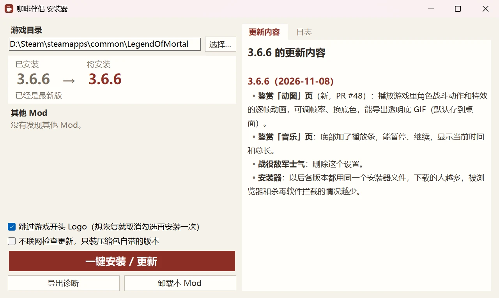

**手动安装**：在 Steam 里右键《活侠传》→ 管理 → 浏览本地文件，把压缩包里的所有内容解压到游戏目录并覆盖。先删掉 `BepInEx\plugins` 里的旧版骰子大师、多功能 Mod、赵活系统等同类 Mod。

**卸载**：运行安装器，点「卸载本 Mod」。存档不受影响。

## 快捷键

| 按键 | 功能 |
|---|---|
| Tab | 咖啡伴侣窗口（此刻、路线图、剧情图、节点存档、随时存档、收集进度、数值、AI 陪玩、设置） |
| F3 | AI 陪玩页 |
| F8 | 设置页；存档界面里给所选存档写备注 |
| F9 | 数值面板 |
| F10 | 备忘录悬浮窗 |
| F5 / F7 / F6 | 随时存档：存新档 / 读最近的 / 看全部 |
| F2 | 一键快进：跳过读过的对话，遇到没读过的自动停下 |
| F4 | 回退到剧情判定前 |
| 右键 | 隐藏界面看 CG |
| 手柄 L3 | 开关咖啡伴侣窗口 |
| ESC | 游戏菜单里增加「空过」「直接获胜」「导出诊断」 |

按键都能在设置页「热键」组里改，也能设成「不绑定」。

## 设置

所有设置都在咖啡伴侣窗口的「设置」页（F8），可以按名称搜索。改动立即保存，需要重启才生效的会标出；鼠标停在设置名上显示详细说明。也可以直接编辑 `BepInEx\config\LOMAssistant.cfg`。

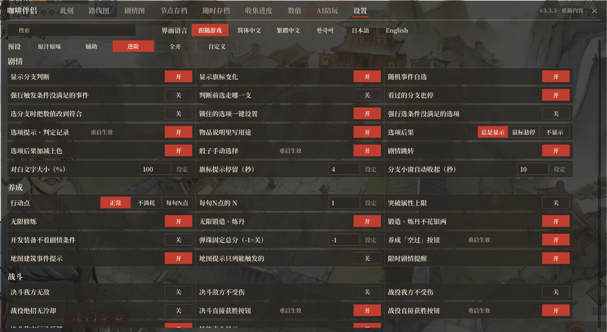

**预设**：设置页最上面可以一键换成「原汁原味」「辅助」「进阶」「全开」四档。预设只改剧情提示、养成战斗辅助和作弊类开关，存档、提速、界面、热键不变。改动其中任意一项后显示为「自定义」，之后还能换回各档。新玩家第一次打开咖啡伴侣窗口时会弹出预设选择，不选就是「辅助」。

| 档位 | 打开的功能 |
|---|---|
| 原汁原味 | 下面列出的功能全部关闭 |
| 辅助 | 选项提示、判定记录；选项后果；锁定选项一键满足条件；骰子手动选择；地图建筑事件提示；限时剧情提醒；养成「空过」按钮；决斗直接获胜按钮；战役直接获胜按钮；战斗失败死亡提示；战斗回合事件提示；讲经堂解锁显示；战役手感优化；无限修炼；无限锻造、炼丹；锻造、炼丹不花银两 |
| 进阶 | 「辅助」的全部，加上：显示分支判断；显示旗标变化；随机事件自选；物品说明显示用途；选项、骰子已读标记；剧情跳转；战役助战选择 |
| 全开 | 「进阶」的全部，加上：分支判定手动选择；强制触发未满足条件的事件；显示未满足条件的选项；四师兄售卖全部物品；开发装备无视剧情条件；决斗敌方行动预测；讲经堂全部解锁显示 |

未列出的功能不随预设变化，可以在设置页单独开关。

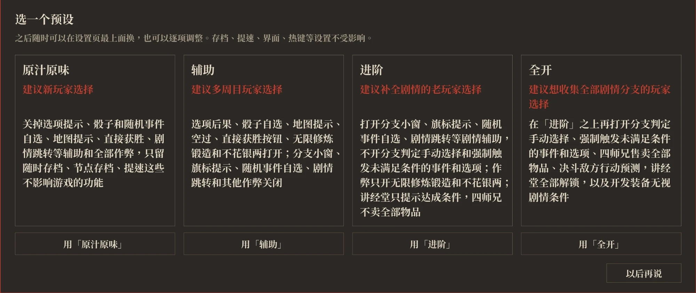

## 功能

下文带「」的设置名与设置页一致。各功能在哪一档预设打开，见上面的预设表。

### AI 陪玩（F3）

用自己的 API Key 接入大模型，问剧情和攻略，或者和游戏里的人物聊天。支持 DeepSeek、Kimi、通义千问、智谱 GLM、硅基流动、OpenRouter、OpenAI、Claude、Gemini、本地 Ollama，以及任意 OpenAI 兼容接口。

- **攻略助手**：先查游戏里的剧情数据再回答，包括任务和触发条件、剧本分岔和对白、各路线的好感和数值合计、结局和死亡、结缘路线、人物志、场所事件、决斗条件，以及当前进度和屏幕上的选项。
- **女主角和大师兄**：九位可结缘的女主角和大师兄唐布衣用各自的口吻说话，立绘表情随回答变化，对你的称呼随剧情变化。他们只知道你读过的剧情。问到攻略时，回答后面另起一段攻略提示，也可以设成只聊天。
- **剧透程度**：分三档，想知道什么说什么、只说当前和走过的剧情、只给方向提示。
- **回答方式**：分极速、标准、深度三档。极速少查资料，回答更快、更粗略；深度换用更强的模型，回答前核对资料，更准，也更贵、更慢。
- **改数值和设置**：需要改数值、好感、心上人、旗标或咖啡伴侣的设置时，AI 先给出一张卡片，点确认后才改。
- **对话**：每位人设的对话存在本地，可以新开、切换、删除，也能导出到桌面；回答边生成边显示。
- **主动陪玩**：选一位人设常驻游戏画面，在你做选择、掷骰、打完一场、好感变化、限时剧情快到期时说一两句，只评论和建议。发言频率分安静、正常、话多三档，可以单独设模型和每次启动游戏的 token 上限；形象能拖动、缩小、暂停发言，点气泡可以去 AI 陪玩页追问。
- **自定义人设**：在文件夹里放人设文字和图片，就能添加自己的人设，在 AI 陪玩页和主动陪玩里都能选；也可以替换内置人设的图片和人设文字。从「AI 设置」打开文件夹，里面有说明。
- **费用和隐私**：按服务商的价格计费，本 Mod 不收费。Key 和对话只发给你选的服务商；导出的诊断里不含 Key。


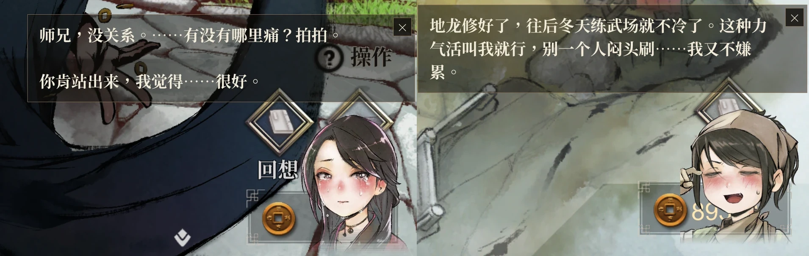

### 剧情回顾（Tab）

- **此刻**：当前这段剧情、所在地点和任务的情况。
  - 剧情：每个选项、转盘的结果，分支的条件，选择之后的剧情是否读过。
  - 地点：当前地点的随机事件、概率和没看过的事件，可以直接选定下次触发哪一个。
  - 任务：现在的主线、支线去哪里触发、还差什么。
  - 战斗：打赢、打输的后果和回合事件；战役还显示胜利条件和战役事件。

  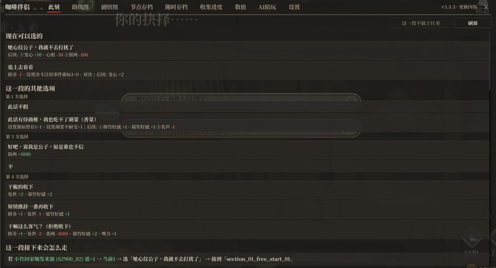

- **路线图**：主线按时间排成一条横线，支线挂在下面。
  - 岔路从主线上下分出，合流时回到主线，岔开的线上写着触发条件；并行的几条路线各占一道，不交错。
  - 打勾的是这一局走过的，红色「今」字是当前所在的主线，下一站套金圈；点「回到现在」跳回当前这一站。
  - 点一站，显示接下来去哪（时间、地点、条件）、触发条件、站内的岔路和选项；选项默认折叠，展开后显示每个选项的条件和后果。支线写明下一步和走完后接回哪一站。
  - 可以搜任务名、地点、台词和旗标，也支持拼音首字母；搜到旗标时列出它在哪些剧情里被改动、被判定。

  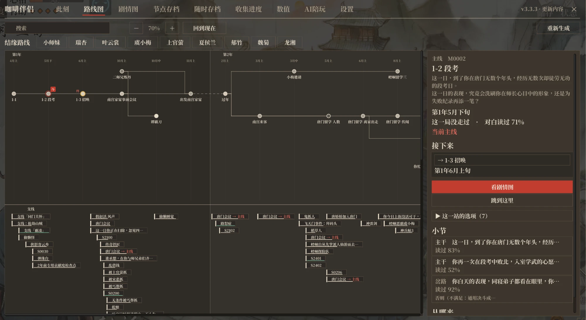

- **结缘路线**：在路线图上选一位可结缘的人物，只亮出和她有关的剧情，列出每一步是否完成、在哪里达成。

- **剧情图**：单个任务的剧情流程图。每个方块是一段剧情，方块里一行一个去处（选项、掷骰、条件），从这一行连到它通向的段落；选了以后仍留在本段的选项也会列出。鼠标停在一行上，显示完整的条件和它改动的内容。崆峒日常、青城日常、江陵等地点的剧情也有剧情图，只能查看。

  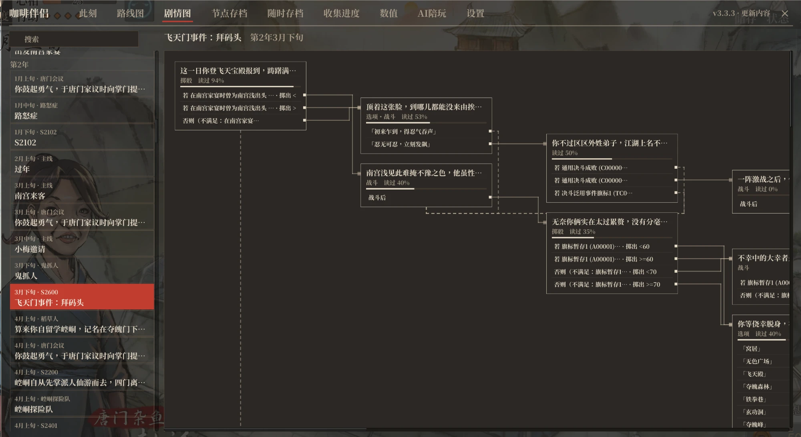

- **节点存档**：游戏在剧情存档点和每旬开头自动存档时，同时记下进度；点「从这里重玩」回到那里，改走另一条路。各存档互不干扰，不占手动存档栏，随 Steam 云同步。

  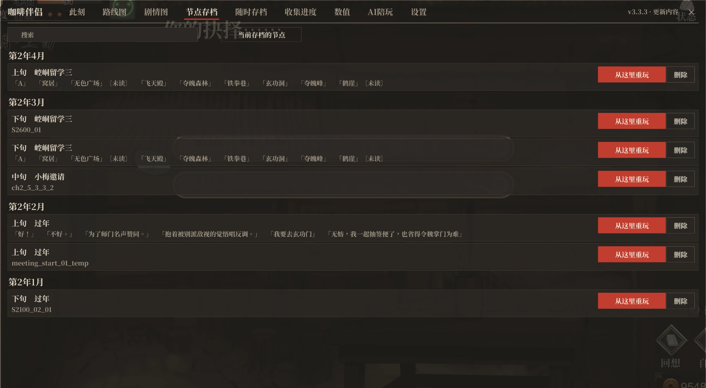

- **剧情跳转**：在路线图或剧情图里选中一段剧情，点「跳到这里」直接从那一段开始玩，还没走到的剧情也可以。
  - 跳转前列出途中影响后续剧情的选择，按所选补上中间的进度，也可以顺便和一位女主角结缘。
  - 目标段落里按条件分的岔路，默认走还有未读对白的一支，跳过去后直接走这一支，不改数值。打开「选分支时自动调整数值」后，先补上这一支的条件，补不上的再直接走。
  - 跳转前自动存一个随时存档，可以随时读回。
  - 中间的剧情没有实际玩过，偶尔会有对不上的地方，正常游玩不建议使用。

  

- **收集进度**：全部周目的记录，分剧情、女主线、结局、死亡、成就、结局 CG。
  - 剧情按各任务的对白已读比例统计；结局、死亡、成就、结局 CG 标出图鉴编号和达成情况，未完成的写明去哪里、怎么走到。
  - 女主线按可结缘的每位角色统计她那条线的对白已读比例和结局，展开按任务列出。
  - 每一项下面列出能通向它的任务，点任务名打开它的剧情图。
  - 「结局 CG」页的「看片尾动画」在剧情场景里重放通关时的片尾字幕，按 Esc 结束。

  

### 剧情辅助

- **骰子手动选择**：掷骰时点任意一条线路，直接选中那个结果。
- **选项结果**：对话选项、掷骰线路后面显示选择的后果。
  - 被锁的选项显示实际的解锁条件，旁边的「一键设置」把条件改到满足。
  - 打开「显示未满足条件的选项」后，条件不满足就不出现的选项也会列出，标红字「条件没满足」，鼠标停在上面显示条件；被锁的选项条件改不到时，旁边改为「强行解锁」，不改旗标直接解开。
  - 「选项后果」可选总是显示、鼠标悬停时显示、不显示。

  

- **选项、骰子已读标记**：在对话选项、掷骰线路后面标出后续对白的阅读情况（没看过、看过一半、看过）。
- **随机事件自选**：工作、闲逛等抽随机事件时先暂停，列出可触发的事件、概率和带来的变化，选一个直接触发，也可以按原概率抽。
  - 按条件区分的变化写明条件；没看过的事件标「没看过」。
  - 条件里带随机数的分支也可以选走哪一条。
  - 每个事件、每条路可以设「总是」「不出」，设置会记住，关掉自选后仍然生效。
  - 打开「强制触发未满足条件的事件」后，出现条件未满足的事件也列在下面并写明条件，点选后无视条件直接触发，不改旗标。

  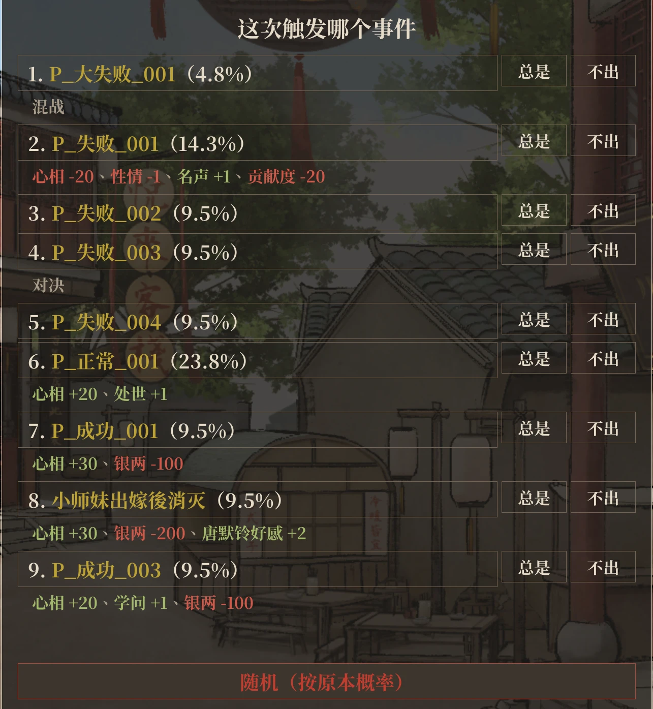

- **分支判定手动选择**：剧情走到按条件分支的判定时，如果换一支能看到未读对白或接到别的剧情，就先暂停，列出每一支的条件、当前值和对白阅读情况，选哪支走哪支。
  - 默认不改数值，只是这一次直接走过去。打开「选分支时自动调整数值」后，先把属性、好感、旗标改到正好满足这一支，改动会保留；改不了的再直接走。
  - 只有一支能走、换一支也没有新内容时不暂停。打开「已读分支也暂停」后，换一支有对白就暂停，读过的也算。
  - 弹出时停止快进。
- **地图建筑事件提示**：养成地图上鼠标停在建筑上，列出这里的主线、支线（能否触发、条件）和随机事件的概率；有可触发且没走过的任务的建筑会一直亮着。
  - 打开「地图提示仅列可触发事件」后，只列现在进去就会触发的，其余只写个数。
  - 进入建筑后，鼠标停在挑柴、修练等选项上，列出这一项会抽到的随机事件、概率和没看过的事件；外出列表里的移动、行商同样适用。
- **限时剧情提醒**：条件已满足但还没触发的剧情，离触发期限不到 3 旬时，在养成地图左上角列出还剩几旬、截止日期和触发地点；「此刻」页的任务也会标出。
- **备忘录**（F10）：浮在游戏画面上的小窗，用来记「在某天之前把某一项做到多少」。
  - 从数值、好感、天赋、设施、物品、旗标，以及功法、锻造、炼丹的层数和进度里搜一个条件，设目标值和截止日期。
  - 窗口实时显示当前值、进度和剩余旬数；达成、回落、临近截止、过期时在窗口顶部提示。
  - 窗口可以拖动、缩放、收起。
- **物品说明显示用途**（可能剧透任务名）：背包和商店的物品说明后面列出使用效果，以及哪些剧情会判定或收走它。
- **显示分支判断**（可能剧透）：分支判定时列出各分支的条件，满足为绿、不满足为红，可选屏幕左侧小窗或屏幕上方提示。

  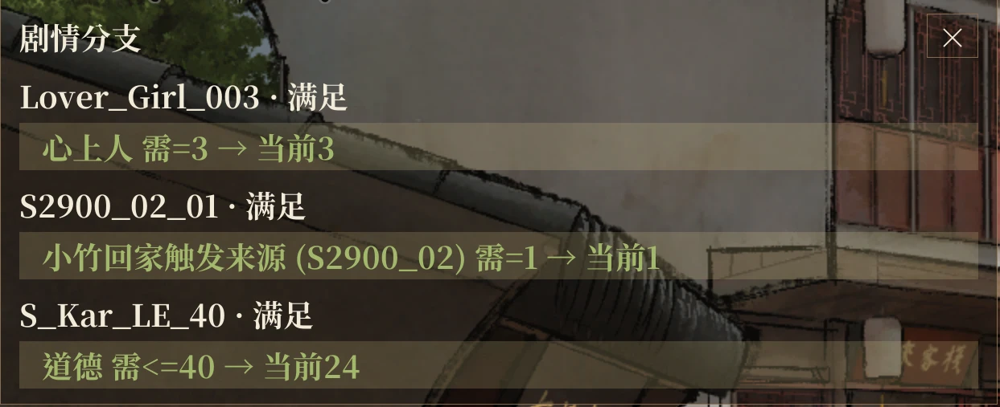

- **显示旗标变化**（可能剧透）：剧情改动旗标时在屏幕上方提示，停留秒数和文字大小可调。
- **判定记录**：剧情经过的判定、条件和当时的值记进回想（对话记录）。
- **隐藏界面看 CG**：剧情里按右键，只留背景、CG 和立绘；再按右键、点左键或按其他键恢复。

### 存档

- **随时存档**：剧情的台词、选项、掷骰时和养成界面都能存，不占原版存档栏；战斗中不能存。
  - F5 存新档，F7 读最近的，F6 打开列表。
  - 列表里可以写备注、看存档时的对白，按存档栏位、保存时间或游戏日期分组，也可以筛选、整组删除。
  - 默认不限数量，可以在设置里设上限。
  - 读取时遮住快进的画面，显示进度并静音。

  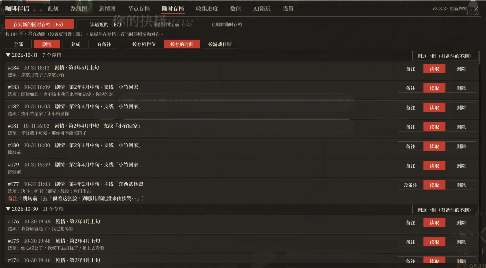

- **回退到判定前**（F4）：剧情遇到判定和分支选择框时自动临时存档，按 F4 回到前一句重新判定、重新选。
- **新版存档、读档界面**：可换回原版。
  - 列表带心上人头像、日期和备注；详情栏显示心上人立绘（已结缘的存档换成害羞的表情）和读档后的头几句对白。
  - 手动、自动存档分两页；打开时自动选中上次保存的存档。
  - 读档页右上角可以切换按栏位排，或最近保存的排在前面；按最近保存排时，存档页最上面先放一个空栏位。

  

- **更多栏位**：手动存档 100 个（原版 20 个），传奇栏位 5 页（原版 1 页 12 个），三类自动存档各多保留 5 个旧档；数量都可以在设置里改。
- **存档备注**：存档界面里选中手动存档后按 F8 写备注。备注随 Steam 云存档同步，可以自动导入 LOM_SaveSlotExpander 和 LOM_SaveSlotMemo 的备注。

### 养成

- **行动点**：正常 / 不消耗 / 每旬 N 点。
  > ⚠️ 后两种可能让部分剧情不触发或提前触发，甚至卡掉关键主线，请谨慎使用、多存档。
- **无限修炼、锻造、炼丹**：修炼、锻造、炼丹不消耗次数和点数；「锻造、炼丹不花银两」是单独的开关。
- **突破属性上限**：原本最高 100 的属性，上限改为 9999。
- **开发装备无视剧情条件**：锻冶场、炼丹房开发新装备、新药时不看剧情条件，等级和门派规模的要求不变。
- **开发项目直接更换**：锻冶场、炼丹房的开发界面显示同类的其他分支，当前项目的等级和门派规模达到要求时可以直接更换，不用先退回默认项目。
- **弹珠固定总分**：离开弹珠小游戏时，把总分改成设定的值。
- **四师兄售卖全部物品**：四师兄的商店卖全部书籍、杂物和特殊物品（《证类本草》除外）。
- **空过**：养成界面、留学地图按 ESC，菜单里的「空过」消耗 1 次行动，不触发事件；也可以在「热键」组里给它绑一个键。

### 战斗

- **决斗回想**：决斗中按 L 或点快进按钮上方的回想按钮，按顺序翻看本场显示过的嘴攻、角色对白和旁白；翻看时决斗暂停，离开决斗时清空。
- **决斗敌人增强**：开战时按主角六项属性总和提高敌人的血量和属性，强敌仍明显强于普通敌人；敌人还会根据双方的气、血量和主角连续使用的招式调整出招。
- **决斗敌方行动预测**：显示敌方本回合预选的招式，窗口可以拖动、缩放。
- **战斗失败死亡提示**（会剧透）：这场战斗输了会走到生死簿里的死亡时，战斗全程在屏幕上方显示死亡名称和生死簿收录情况；输了之后还要看其他条件的显示「可能会死」；选项触发的死亡不提示。
- **战斗回合事件提示**（会剧透）：决斗到某个回合会结束战斗或改动旗标时，在屏幕上方显示下一个这样的回合。
- **战役手感优化**：
  - 修复硬直后方向键失灵。
  - 普通攻击自动朝向最近的敌人，判定范围扩大，主角脚下显示攻击范围。
  - 平射暗器自动瞄准最近的敌人，蓄力抛射不再落空。
  - 主角绝招「奋力一击」和掉落物拾取的范围扩大。
  - 主角不再被我方的暗器、陷阱和毒雾误伤。
- **战役助战选择**：开战面板的绝招列表加入好感度达到 40 的同伴，不限于剧情指定的同伴。
- **直接获胜**：决斗、战役中按 ESC，菜单里有「直接获胜」。
- **技能表完整显示**：战斗时我方技能列表过长会自动分列。
- **战斗作弊**：「决斗我方无敌」「决斗敌方不受伤」「战役我方不受伤」「战役绝招无冷却」四个开关，各档预设都不打开。

### 数值面板（F9）

角色数值、武功、门派、好感（所有人）、天赋、功法和锻造炼丹点数、设施、书籍、物品、旗标都在一页，每行可以加减或直接设定；可以按名字、编号、说明或拼音首字母搜索。

- **书籍、物品**：直接改数量，和在商店买到一样会推进相关任务。鼠标停在武学书名上，列出每一层练成时加的属性，已练成的打勾。
- **数值**：可以调到秘笈等加成以下，也可以调成负数，之后剧情加减、读档都保留。
- **心上人和称号**：心上人显示名字；心相、四种性格（性情、处世、修养、道德）、阴阳在数值后面显示当前称号。称号可以从全部称号里更换，也可以自定义。
- **锁**：心相、四种性格、阴阳、银两、贡献度各有一把锁，锁上后剧情和选项都改不动它，重启、换存档后仍然锁着。
- **旗标**：一千多面，分门派好感、人物、六道、剧情等几类。
- **反查**：点旗标、书籍、物品的名字，列出它在哪些剧情里被改动、被判定；点好感的人名，列出被判定的地方。都能跳到剧情图。
- **数值预设**：在数值页改过的项会被记下，点「数值预设」存成一个预设；换存档或开新档后点「套用」，一次把这些项设成保存的值，没改过的不动。

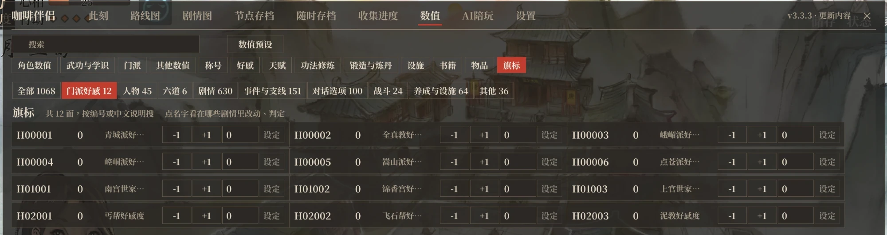

随意改动数值、旗标可能让剧情出错，改之前先存档。

### 提速

- **游戏倍速**：1x / 2x / 3x / 5x。战役和自动播放的对白保持原速；打开「倍速作用于战役」后战役也加速。
- **一键快进**（F2）：剧情里按一下，持续跳过读过的对话，再按一下停止；遇到没读过的对话自动停下。
- **流程提速**：切场景、读档、快进更快，数值变化后的停顿缩短，决斗回合之间不再等待。
- **启动加速**：标题画面的开场动画加快；安装器可以设成跳过开头 Logo。

### 标题画面

标题画面增加「练功塔」「鉴赏」两个按钮。

- **练功塔**：游玩试玩版的练功塔模式，可以触发生死簿里只有这个模式才有的死亡。
- **鉴赏**：分 CG、立绘、动图、决斗、音乐五页，支持手柄。
  - CG：看过的才显示，场景图全部开放；页面上的开关可以显示未解锁的内容。
  - 立绘：选背景、摆放角色、切换差分，可以隐藏界面后截图。
  - 动图：播放角色战斗动作和特效的逐帧动画，可以导出透明底 GIF。
  - 决斗：决斗里每个角色的战斗立绘，分正常、攻击、受击、防御，可以缩放、拖动，导出透明底 PNG。
  - 音乐：官方原声带全部 39 首，可以暂停、看播放进度。
- **标题画面人物**：可以指定显示哪一位，也可以全部显示或不显示。

### 界面和其他

- **界面**：窗口配色可选浅色、深色、跟随系统；字体可选思源宋体或微软雅黑；咖啡伴侣窗口、小窗、提示框的不透明度分别可调；游戏文字和对白文字可以放大。
- **手柄**：咖啡伴侣窗口全程可以用手柄操作（L3 开关，左摇杆移动，A 点击，LB / RB 切页）；骰子手动选择、空过、随机事件自选也支持。
- **多语言**：界面随游戏语言显示简体、繁体、韩语；装了[日语补丁](https://dlaqe2334.github.io/LOM-JPMOD/)时显示日语，装了英文补丁时显示英语；也可以在设置页手动选择。
- **讲经堂**：鼠标停在汗青书、生死簿各项上显示达成条件，也可以设成全部显示为已解锁。
- **导出传奇**：「状态 → 传奇」里可以随时把这一局的传奇导出成 txt。
- **后台继续运行**：切到别的窗口时游戏不暂停。
- **导出诊断**：游戏 ESC →「环境设定」→「导出诊断」，把日志和配置打包到桌面（不含存档）；安装器里也有。
- **冲突检测**：装了会冲突的旧 Mod 时，在设置页最上面提示；只是改了同一处、可以共存的不提示。和别的 Mod 快捷键冲突时，自动让出本 Mod 的按键。
- **更新提示**：窗口右上角可以查看每版的更新内容，有新版时红字提示。

## 常见问题

**遇到 bug 怎么办？** 先重新运行一次安装器，确认是最新版。还有问题就用「导出诊断」，把桌面上的压缩包发到 [QQ 群](https://qm.qq.com/q/22cO11mHBq)或 [Issues](https://github.com/kevinnie2003/LOMAssistant/issues)，并说明问题是怎么出现的。

**装了没反应？** 从托盘完全退出 Steam 再打开游戏。还不行就用安装器里的「导出诊断」。

**游戏放在中文路径下？** 路径里有中文等非英文字符时 BepInEx 会加载失败。把游戏文件夹移到只有英文、数字的路径下（Steam 库里右键《活侠传》→ 属性 → 已安装文件 → 移动安装文件夹），再运行一次安装器。

**选项结果不显示、骰子不能自选？** 和旧版骰子大师、多功能 Mod 冲突。安装器会自动处理；手动安装请删掉 `BepInEx\plugins` 里的旧 Mod。

**能和其他 Mod 一起用吗？** 能，功能不冲突的 Mod 可以一起装。快捷键冲突时本 Mod 自动让出，可以在设置页「热键」组里另绑。别的 Mod 如果自带一份 BepInEx，装完后重新运行一次本 Mod 的安装器。用 Binarizer 加载的剧情 Mod 也能一起用：剧情图、鉴赏读取 Mod 的剧本，随时存档能在 Mod 剧本里存读；Mod 写在脚本里的判断不显示，装上 Mod 后，走过被改动剧本的旧随时存档无法读取。

**Linux / Steam Deck？** 手动安装后，在 Steam 启动选项里加 `WINEDLLOVERRIDES="winhttp=n,b" %command%`。

## 开发

需要 .NET 8 SDK 和装好本 Mod 的游戏目录（编译时引用游戏和 BepInEx 的程序集，仓库里没有游戏文件）。

```bash
GAME="D:/Steam/steamapps/common/LegendOfMortal" DOTNET=/path/to/dotnet ./build.sh
```

```bash
DOTNET=/path/to/dotnet ./Installer/build-installer.sh
```

第一条编译 Mod 并装进游戏目录，第二条编译一键安装器。

| 目录 | 内容 |
|---|---|
| `LOMAssistant/` | 插件入口、日志、诊断、选项提示等 |
| `LOMAssistant.Config/` | 配置项 |
| `LOMAssistant.Features.*` | 各功能（`Extras` 是本项目新增的，`AnytimeSave` 是随时存档） |
| `Installer/` | 一键安装器 |
| `tools/anytime-contract/` | 游戏更新后重新生成随时存档的兼容契约 |
| `tools/bepinex-patch/` | 给打包的 BepInEx 打补丁：修复游戏装在中文路径下 BepInEx 启动失败 |

## 许可证

[MIT](LICENSE)

## 代码签名政策

Free code signing provided by [SignPath.io](https://about.signpath.io/), certificate by [SignPath Foundation](https://signpath.org/).

安装器（`咖啡伴侣安装器 Installer.exe`）由 GitHub Actions 从本仓库的源码构建后签名，每次签名都由维护者手动批准。

- 作者和审核者：[kevinnie2003](https://github.com/kevinnie2003)，其他人提交的 PR 由作者审核后合并
- 签名批准者：[kevinnie2003](https://github.com/kevinnie2003)

**隐私**：除了下面这些由使用者打开或要求的情况，本程序不会向其他联网系统传输任何信息。

- 安装器打开时从 GitHub 读取最新版本和更新内容，点安装时下载新版压缩包。勾选「不联网检查更新，只装压缩包自带的版本」后不联网。
- Mod 进游戏后从 GitHub 读取最新版本号。关掉设置「检查新版本」后不联网。
- AI 陪玩在玩家提问时，把问题和相关的游戏信息发给玩家自己设置的 AI 服务商；玩家打开「主动陪玩」后，每次发言前把最近的对白和事件发给同一服务商。

## 致谢

本项目不是从零开发的，功能思路和部分代码来自以下作者：

- **[活侠传助手](https://mod.3dmgame.com/mod/256420)**：爱死（3DM：wowowo4567）。本项目的基础，源码由其发布的插件反编译而来后再修改。它又整合自 [骰子大师](https://mod.3dmgame.com/mod/210536)（Gmhaxx）、[多功能 Mod](https://mod.3dmgame.com/mod/210629)（Jim97）、[任意位置存档](https://mod.3dmgame.com/mod/210679)（NothingNullNull）。
- **部分功能思路**：参考 [赵活系统](https://github.com/Toufff/zhaohuo-system)（Toufff，MIT 许可）。
- **AI 陪玩**：思路参考 [江湖夜话](https://github.com/Cpjjason/jianghu-yehua)（Cpjjason），它也是《活侠传》的 AI Mod，能和游戏里的人物私下闲谈，人物会送东西、指点武功、记得聊过的事（[B 站介绍视频](https://www.bilibili.com/video/BV1s2nC6pE83/)）；部分性格和小习惯参考了类脑社区夏呆呆的同人角色卡《活侠传》。
- 感谢 [lxsb222-spec](https://github.com/lxsb222-spec)（爱死）、[blakceyes](https://github.com/blakceyes)、[NEXTAltair](https://github.com/NEXTAltair)、[pluvivanto](https://github.com/pluvivanto)、[lockpick](https://github.com/lockpick)、[F1-ZX](https://github.com/F1-ZX) 提交的 PR，以及 [mahosalieri85-a11y](https://github.com/mahosalieri85-a11y)、[iampigcheng](https://github.com/iampigcheng) 提交的 issue。
- 下载包附带的 [BepInEx](https://github.com/BepInEx/BepInEx)、[UnityDoorstop](https://github.com/NeighTools/UnityDoorstop)、[Newtonsoft.Json](https://github.com/JamesNK/Newtonsoft.Json) 按各自的许可证分发。
