# 咖啡伴侶

[简体中文](README.md) · **繁體中文** · [English](README.en.md) · [日本語](README.ja.md) · [한국어](README.ko.md)

《活俠傳》（Legend of Mortal）的 BepInEx 6 插件。名字取自玩家給瑞杏起的外號「咖啡」（瑞杏與瑞幸咖啡同音）。適配最新版遊戲，並加入 AI 陪玩、劇情回顧、分支自選、修改面板、存檔優化等功能。

[](https://github.com/kevinnie2003/LOMAssistant/releases/latest/download/LOMAssistant.zip) [![Nexus Mods](https://img.shields.io/badge/Nexus%20Mods-%E4%B8%8B%E8%BC%89-D98F40?style=for-the-badge&labelColor=8A5A28&logo=data%3Aimage%2Fpng%3Bbase64%2CiVBORw0KGgoAAAANSUhEUgAAACAAAAAgCAYAAABzenr0AAAEXElEQVR4AazW7XkTOxAF4E0auaYSQiVAJQmVECrBVEJuJeG8Y42stR3yBz%2BalTQfZ45GWq3vt3%2F8e319PUQeI7%2BH%2FEz%2F8FaamwQSAOQh%2FVUgXUSC7%2BmBt5g%2FJtHvyFPkMARG%2B9BFfW47AgGU%2BGfMQPQCrUQvwWts9BJ8yRh4izl91LO9zNG28YNz2JbfJCB59BJzzHA2AXQSTOU7g6e70%2B9D%2FL5GmggsJOBFvW2TQGbfI90EHDN5jujTVWu9lX6KZhU69k%2FJ%2FS22ahnD4KenQ2LmKgJZPUWzKhCeCcaeCJYAEEKqYStWYf%2BaGHbhU6KDiRQceltd%2Be6T3AAgAwEi4GXYJBHMZosksgrzVcRdJQ%2BGZBYIZ42rsQp8XlBWEEkFqkAnXlx3w2NW2aubhiS3OIm32J2HH9M4BghwqmmcJkjGqmBeAOXw9gPZnXVJXrYx%2F7g4VbUQaJ2EPa4%2BJAQrec1vPBBcq1YuI1kTdzdYuWrOrQ525UOgBom0V9Mh82pxRMI21DwPSdNVO8S%2BzkuZh6Tpqtlr2wynFHnU6tPXa7ga3HAC2KaMJPYQkdX%2Fynesfm7rALlc2Iy7Dzg2vQqGLt2IPXXxe4k8R1Rs%2Bo%2BEJ6c8Y4fndc1s1%2F7LjC3dptpyVQUofnkMOQbU9Xu5imGuzp7WII86WIkBqoJ9Xce0a6pwVT1ngFeBGESAY%2BfuJ8ZRn9tYZa%2FmS5Kr2nuv6iVO5WwCZ%2FRtU%2BItPwFYu7v1UW1bktVKa3J68FurJR65v709IsXNLaBoKUNP0tc8iZXXKgnwy6R0vgMfUqFbZyBQu4boJFCTxWwFy3TzDktQZIZhF5Ok3yIzLmP77c2ZusSt8f9nPgnUhOIdkXT91Da4bVkrUjAh4c1RDeTFehPK1o8%2BA4yte8yggTOcTWLltbJWOrA9dtn0eNeHiBhE5lmKw%2FkQxkHCJqFMK3B8qz3lHLDVZDzEjeFWFYjPmmTrX3LAR6JV9ZevK9BKvSSqoGzmLb54QHruC2feJGyDOK%2FuzXtkkHCbwpDn80qAgqHF5dTgEnVg272SVts%2B9E0aFiII0a%2By%2Bj8UgYuyuWbtmZPfSX3xkJhAI4ZPJ522MUDCtu1IjCo01qEIJGA9nb%2BGEyJuOO%2F2yjru1XbApdk%2FJLGA2us2DeLIUT03AZOWj3GS%2BCFEnPqr5LFL3iAdt%2FZiHDhvhgOtUrZMTI2H849bBHzjrRrA8Dt3Se602%2Fuz8nR9W7HtEIeARdg6lWTjvyZ3qI9NAEsORMlWR7qSkRywMyKRErvt9BJZITsiYh4To1pW7wpHnr4vqNNNmFJjCISR%2BMJ5lWqlAelXDDg7gsZ6wMaSlj%2BHCDLm9BKbR11t5uoKeKetwGrKIw8BXiUJCKCo320WA%2BstR9tri8o%2BCZiNSiCxAiDC3IKIFRBjvnrAgbhzcNng9DaZOw93%2Bc3kAHcEKOJgfyogc%2BDpNquSBLivnr9mxBiwfgc8cI7p%2BZVsN35%2FAAAA%2F%2F8CpstnAAAABklEQVQDAC6567qqPgZJAAAAAElFTkSuQmCC)](https://www.nexusmods.com/legendofmortal/mods/10) [![夸克網盤](https://img.shields.io/badge/%E5%A4%B8%E5%85%8B%E7%B6%B2%E7%9B%A4-%E4%B8%8B%E8%BC%89-4C6EF5?style=for-the-badge&labelColor=3249B8&logo=data%3Aimage%2Fpng%3Bbase64%2CiVBORw0KGgoAAAANSUhEUgAAADAAAAAwCAYAAABXAvmHAAAKYUlEQVR42t2aeXBV1R3HP7%2B75OUleYGELQQQRKlYceuog1o7FFuLg9Sldew41YpaHcelLTod26qxtrXDuA1TxtppnQHrUtO6YO1ULRpArVstigiCgkACCSRkf3nbvefXP8595JGEkMSl6pk5M%2B%2Fdd%2B8539%2Fv9%2F1t5z4A6Tvr6uo8oqGqM1T1ElV9SFU3qmqXqob68Y8wWntjtNclqjojjyPCJAPM3i81NTVOTU2NEwE%2FXFXvUdVd%2Bv8buyIMhwMU4OsvQB%2Fwl6pqfcFCuUhD5lMAbaK9cgXX6lX10gMIYcHX1dV5quqo6h0FD2Y%2FIboMh1bZgu93qKpTV1fnFQiBqGpe84v7aOGzMgqtvzjCagWora11owsLoxuCT4kqI6FWEH1eCFBbW%2BtKBH468CIwEVDA4bM5TESbRuA0EdmaB3otUA0EHwW8UTtH%2BvsQhhNhrI4wI5H2XwKqRqp9A6iCtWd%2FsI7YmR9BCK4DIh%2FJCk3AVz1gTkSdEHBHspoTBeP6tPKfFuXlXcrGRtjbCvQIYx34cqXDqdPhhENh0theIR0ZkRXCCPMcUdWHge9FP8pIwLcEyh%2BaDA9uC3mvCSQJftLB6QLpEkynQ9ABYYdw9CT4%2Ftfhh%2FOgomzEQuSJ%2BBdR1Y3AzOjikJcKAA94I2O4piHH682Kn4KylIMkIdvuELYBnYLf7RDrAU0K3UlIZ%2BG0WbDkSjj%2BMEspzx22AAK8J6raBZSNRPPP5EIWtmTY3Q3lGUG6ha42IWyDiqzDqB6BDqFzj9C63aEohPK4fb4rBVUVsGwRzD1mxJboFlUNh%2BO4edHXhTm%2B3ZOkIetTkhZMj5DsgBPV5dyEy3GlDhNjQCA0tcJbm%2BCxNfDmFigvsQ7fnYHJY%2BCJm%2BGYaTYQDNOxjaiqDpd4nRpwUaqeF0PwKCcZFKNJ4caYz1WjPcb7A6NoaoN7n4a7V1iN%2BS6098DXjoIVNZAojhxRhufRw6COIsCKoJENpoFq6aSUVuJeN78bV0TNOJ%2FxvpBTCBTCaAYGcqGlzG0XwV2XWW2HCqNKYfV6%2BPPzFvhw84QzHN67CJ2aYU2wmTHSQYW0IdLMT3zl8phHiGIAX8ATSxNXwHOstvO54coz4ar50JGMfnfhkVXQ1m3zw3CEGAb3lcDANtNCg%2FmAidJJEU2c6qW4obgCoiRitJdq%2FTaTfJMEPzobZk6BZMY69mub4N3tEBow5mMWQCNwngPbdAcJ2Uu5tFLhNjKqO8azu2O8kzSkjdW8cGAh8jSZNAbmnwCpHitYaGDNemsBzx26EN5Q6htHIBMKyzcpb5ZvZ%2BL4doIgwyg35PmGGPfuhNGVaU6u8LhwnMuFlS6OFGTpQgGw4FwHjp0OfpH1j7JiuP85SGXgsnkwbfzQQuugFgiNXWBTm7LgqZCrVge0ppupdFqpdHeTCNsoViFRAkbgnx2GhfVZztyRYUPG7Ku8BrICURSKF0Va96CxFX79CMy7CR5%2F2e59MH9wBqWNA%2Bv2wIK%2FGv71oZJwhFFkKKeF0exlrNNEKkjRlYVAlIpiKPbhuR7D%2FKYsq9IGLwoA%2B60dgapvgc5G2NthE1txEVSWw4dNcPFdsPz5gwvhHYg2AuzsgsufCtnaolSUQjYrZFJCpdtCEMbwnE4unbKXd0vhhSzUG6XMhUQRbMdwcVuGZ8fFONJz9qtT3KhsOPME0EXQ0Q0vbYCXN0DMh7I4pLJw7e9hyjibqcOIdgcVQAvMvPRVwxtboGK0kM0Y1PU4xB1FOc2IlGJkO%2FOqPqCqCt5PF7G0De5LBri%2BUuZDvSg%2FS%2BV4MhHbL4vneT1rqp0ArV3w1Gvwi%2BU2nMZjNsze%2FAAcewtUJgb2iX4yaXTTpj3wwKtQ6oFmbbT4%2BYmw6MjDcINmSp0uHIrYlNtOQMCMYp8lE30WT%2FDJ%2BRD6UBxTVmvI6jC0zjuApXOBLeYqE3DJN%2BCBG6xDZ7I2yf17A6x8K%2FIbHYYPrNoMu5ohrtDdLsydLNxwCiSYis802rWUDjOD9bqTNt1FCIQYfpzwOK%2FMIe0ZYg60q%2BGVwOxLhn3zgu%2F1hs0ghNOPhWsWQDIdOboPf3spUqwzBAHyJnpli%2BIbMGnBZOD8Ix1iniLmEEqcs9itJbRrNQ2mhLrgDVzAjZabF3P3tU0CtEVeO1jIc5wofyiccwpMnWBDapEHr2%2BGdG4YUSg0UL8H3AAyPcL4GMwc56AYfPGYKKfTRTWtVJDWKfw92MJDubU0apodJsfjuQAHQSOrx6K4ebDc5ERt5hGToXoMZAOr0O4UtHTu76ODRiEFsmmQnEAAvifEHBBcQpTpzmzG8RZvmu0EMoakqWBpdhvLs8JureYdU0JchCwQF%2BH4yKwHLTLFWqDItTXSvvJaeinVt%2B0a0AKuA2PjgqbBD4T2VqFxr302VPCJMd%2B7gJhMp8nESTEaGMNmE2OL8UkgeEBKYb7ncZbvRcXgQUqWSL27WqE92esbjsDYxMBNr3MARTBrEmR7BD%2BErlZYsy4KgQgGpdqp4uqi85niTGOnidOocXooI8CnU5VOVeb6LkuKi%2FALDzIHK1uM1fia9bBllw2loYFDq2z%2FPJAVnYEWAfj6UeAaCANIlMBDq2xI81xAhcAoX5IJ3F50Btf5szhZxjNBS5mMy1zX47exGI8VF1Mt0q%2FZVu0trY3aPUO1azd3wt2PQxjaUiOVhgUn2eQ3UOvVryPL8y6Vhe%2F8Bp79L1SWQVcPHD4J%2FnQdzJ5JP0IalBYUgzAW8AogFyagwdrGHXvgiqWwci2MKrGRp7IMVt5uHXugRDZgSxmGVuIX3oZzfmUx%2Bi70ZOzCC8%2BA82bD6IS9z6AUIfgFJxYZQNTeP7Z8f%2FChgYYW%2Bz0wVjl16%2BDef1ghSqPWsr0L7rwCrj%2F3wKXEAZv6%2FGb3PAnX%2F9HWJ75nM2d32gpUVWGrSS0IbxoBzyed0hj89Hy44DSrweYOuOVBqHs7KtMD2N1mqVIahyLfUqqjG35wBtx3tb0mMqAPmUGPVYyxQO5%2BAn75sLVAacwWXGFUBgxWKbqO1e7MKfDMbbYwW%2Fo0XLsEEqN6i8Z8Ns4GVhCDPfhavBAS8UFp1%2B0BDQc62HKi%2FnTRuXDUVFhcC6%2B%2FDx2t4Pp20301ivQ%2Fe1EDJrQC5y0Sj0JSLrT3GbX%2BFmbAj8PRh8I1Z8HCbw56%2FJjfscED1gJHMEgfqwrf%2BgqcfhyseMWWvR80Qnu3rV%2F2i7%2B6%2F8eyuFXApDF2ne%2BeBluaLIVErGCJOEyvgpOOgLNnw%2BjS3ogzSEemwFqJ3j3df7DD3b6aSGYgnbE0U7G8p9AaaqlQXtLrJ4VxfG9n1PE51kKJeH%2FqDtYsRlgvG9bxuqrdVGTgiDBYgsoDymu2L6fz%2BWAIx%2B77Ha87IrIVeDS6GA5aqkRnOK4zQDI6wOxbBudrm7735NcewqlcGGF9VES2fv5fMdXW1rqRFW4qYLF%2BBsFrgYfdJCJb8y8oP9evWd18oXjrrbe606ZNWwmUAqdG13NDLCQ%2FScrk36UIcCdw45w5c9xly5bp6tWr%2BWL81eAL8WePz%2Bvfbf4H2PlshlOFzAkAAAAASUVORK5CYII%3D)](https://pan.quark.cn/s/e78c41abcebc)

[](https://www.bilibili.com/video/BV1tNno6ZEf7/) [![QQ群 496887060](https://img.shields.io/badge/QQ%E7%BE%A4-496887060-12B7F5?style=flat&logo=data%3Aimage%2Fsvg%2Bxml%3Bbase64%2CPHN2ZyBmaWxsPSIjZmZmZmZmIiByb2xlPSJpbWciIHZpZXdCb3g9IjAgMCAyNCAyNCIgeG1sbnM9Imh0dHA6Ly93d3cudzMub3JnLzIwMDAvc3ZnIj48dGl0bGU%2BVGVuY2VudCBRUTwvdGl0bGU%2BPHBhdGggZD0iTTIxLjM5NSAxNS4wMzVhMzkuNTQ4IDM5LjU0OCAwIDAgMC0uODAzLTIuMjY0bC0xLjA3OS0yLjY5NWMuMDAxLS4wMzIuMDE0LS41NjIuMDE0LS44MzZDMTkuNTI2IDQuNjMyIDE3LjM1MSAwIDEyIDBTNC40NzQgNC42MzIgNC40NzQgOS4yNDFjMCAuMjc0LjAxMy44MDQuMDE0LjgzNmwtMS4wOCAyLjY5NWEzOC45NyAzOC45NyAwIDAgMC0uODAyIDIuMjY0Yy0xLjAyMSAzLjI4My0uNjkgNC42NDMtLjQzOCA0LjY3My41NC4wNjUgMi4xMDMtMi40NzIgMi4xMDMtMi40NzIgMCAxLjQ2OS43NTYgMy4zODcgMi4zOTQgNC43NzEtLjYxMi4xODgtMS4zNjMuNDc5LTEuODQ1LjgzNS0uNDM0LjMyLS4zNzkuNjQ2LS4zMDEuNzc4LjM0My41NzggNS44ODMuMzY5IDcuNDgyLjE4OSAxLjYuMTggNy4xNC4zODkgNy40ODMtLjE4OS4wNzgtLjEzMi4xMzItLjQ1OC0uMzAxLS43NzgtLjQ4My0uMzU2LTEuMjMzLS42NDYtMS44NDYtLjgzNiAxLjYzNy0xLjM4NCAyLjM5My0zLjMwMiAyLjM5My00Ljc3MSAwIDAgMS41NjMgMi41MzcgMi4xMDMgMi40NzIuMjUxLS4wMy41ODEtMS4zOS0uNDM4LTQuNjczek0xMi42NjIgNC44NDZjLjAzOS0xLjA1Mi42NTktMS44NzggMS4zODUtMS44NDZzMS4yODEuOTEyIDEuMjQyIDEuOTY0Yy0uMDM5IDEuMDUxLS42NTkgMS44NzgtMS4zODUgMS44NDZzLTEuMjgyLS45MTItMS4yNDItMS45NjR6TTkuOTU0IDNjLjcyNS0uMDMzIDEuMzQ1Ljc5NCAxLjM4NCAxLjg0Ni4wNCAxLjA1Mi0uNTE3IDEuOTMxLTEuMjQyIDEuOTYzLS43MjYuMDMzLTEuMzQ2LS43OTQtMS4zODUtMS44NDVDOC42NzIgMy45MTIgOS4yMjggMy4wMzMgOS45NTQgM3pNNy40MjEgOC4yOTRjLjE5NC0uNDMgMi4xNDctLjkwOCA0LjU2Ni0uOTA4aC4wMjZjMi40MTggMCA0LjM3Mi40NzkgNC41NjYuOTA4YS4xNC4xNCAwIDAgMSAuMDE0LjA2MWMwIC4wMzEtLjAxLjA1OS0uMDI2LjA4My0uMTYzLjIzOC0yLjMzMyAxLjQxNi00LjU1MyAxLjQxNmgtLjAyNmMtMi4yMjEgMC00LjM5LTEuMTc4LTQuNTUzLTEuNDE2YS4xMzYuMTM2IDAgMCAxLS4wMTQtLjE0NHptMTAuNDIyIDguNjIyYy0uMjIgMy42NzYtMi40MDMgNS45ODctNS43NzQgNi4wMjFoLS4xMzdjLTMuMzctLjAzMy01LjU1NC0yLjM0NS01Ljc3My02LjAyMS0uMDgxLTEuMzUuMDAxLTIuNDk2LjE0Ny0zLjQzLjMxOC4wNjMuNjM4LjEyMi45NTguMTc2djMuNTA2czEuNjU4LjMzNCAzLjMxOC4xMDN2LTMuMjI1Yy40ODguMDI3Ljk2LjA0IDEuNDA2LjAzNGguMDI1YzEuNjc4LjAyMSAzLjcxNC0uMjA0IDUuNjgzLS41OTQuMTQ2LjkzNC4yMjcgMi4wOC4xNDcgMy40M3pNMTAuNDggNS44MDRjLjMxMy0uMDQxLjU0Mi0uNDA5LjUwOC0uODI1LS4wMzMtLjQxNS0uMzE0LS43Mi0uNjI5LS42NzktLjMxMy4wNC0uNTQxLjQwOS0uNTA4LjgyNC4wMzQuNDE3LjMxNS43Mi42MjkuNjh6TTE0LjQ3OSA1LjE1NmMuMDc4LjAzNy4yMjEuMDQyLjI4OS0uMTQ2LjAzNS0uMDk1LjAyNS0uMTY1LS4wMDktLjIxNC0uMDIzLS4wMzMtLjEzMy0uMTE4LS4zNzEtLjE3Ni0uOTA0LS4yMi0xLjM0MS4zODQtMS40MDUuNDk5LS4wNC4wNzItLjAxMi4xNzYuMDU2LjIyNy4wNjcuMDUxLjEzOS4wMzcuMTc5LS4wMDYuNTgtLjYyOCAxLjIxLS4yMDggMS4yNjEtLjE4NHoiLz48L3N2Zz4%3D)](https://qm.qq.com/q/22cO11mHBq) [](https://github.com/kevinnie2003/LOMAssistant/releases) [](https://github.com/kevinnie2003/LOMAssistant/stargazers) [](https://github.com/kevinnie2003/LOMAssistant/commits/main)

## 安裝

壓縮包已包含 BepInEx，不用另外下載。

**一鍵安裝（推薦）**：解壓後雙擊 `咖啡伴侣安装器 Installer.exe`，點「一鍵安裝 / 更新」。安裝器會自動找到遊戲資料夾，連線下載最新版（連不上 GitHub 就裝壓縮包自帶的版本），並把已知會衝突的舊 Mod 移到 `BepInEx\DisabledMods`（不刪除）。以後更新再執行一次即可。

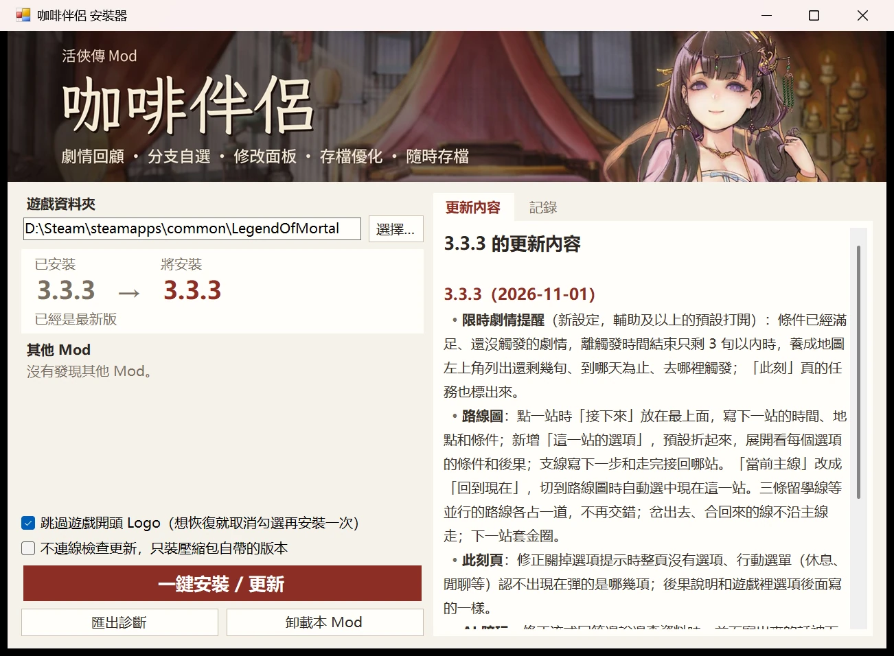

**手動安裝**：在 Steam 裡右鍵《活俠傳》→ 管理 → 瀏覽本機檔案，把壓縮包裡的所有內容解壓到遊戲資料夾並覆蓋。先刪掉 `BepInEx\plugins` 裡的舊版骰子大師、多功能 Mod、趙活系統等同類 Mod。

**卸載**：執行安裝器，點「卸載本 Mod」。存檔不受影響。

## 快速鍵

| 按鍵 | 功能 |
|---|---|
| Tab | 咖啡伴侶視窗（此刻、路線圖、劇情圖、節點存檔、隨時存檔、收集進度、數值、AI 陪玩、設定） |
| F3 | AI 陪玩頁 |
| F8 | 設定頁；存檔介面裡給所選存檔寫備註 |
| F9 | 數值面板 |
| F10 | 備忘錄懸浮窗 |
| F5 / F7 / F6 | 隨時存檔：存新檔 / 讀最近的 / 看全部 |
| F2 | 一鍵快進：跳過讀過的對話，遇到沒讀過的自動停下 |
| F4 | 回退到劇情判定前 |
| 右鍵 | 隱藏介面看 CG |
| 手把 L3 | 開關咖啡伴侶視窗 |
| ESC | 遊戲選單裡增加「空過」「直接獲勝」「匯出診斷」 |

按鍵都能在設定頁「熱鍵」組裡改，也能設成「不綁定」。

## 設定

所有設定都在咖啡伴侶視窗的「設定」頁（F8），可以按名稱搜尋。改動立即儲存，需要重啟才生效的會標出；滑鼠停在設定名上顯示詳細說明。也可以直接編輯 `BepInEx\config\LOMAssistant.cfg`。

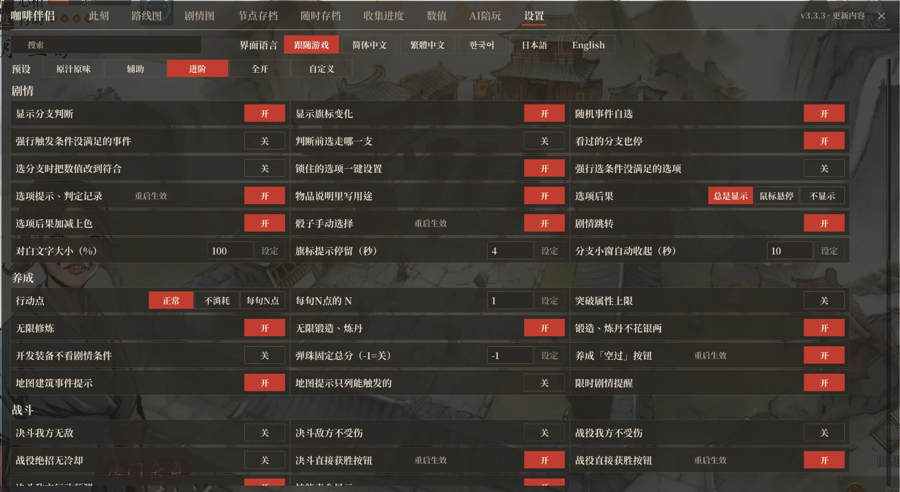

**預設**：設定頁最上面可以一鍵換成「原汁原味」「輔助」「進階」「全開」四檔。預設只改劇情提示、養成戰鬥輔助和作弊類開關，存檔、提速、介面、熱鍵不變。改動其中任意一項後顯示為「自訂」，之後還能換回各檔。新玩家第一次開啟咖啡伴侶視窗時會跳出預設選擇，不選就是「輔助」。

| 檔位 | 開啟的功能 |
|---|---|
| 原汁原味 | 下面列出的功能全部關閉 |
| 輔助 | 選項提示、判定記錄；選項後果；鎖定選項一鍵滿足條件；骰子手動選擇；地圖建築事件提示；限時劇情提醒；養成「空過」按鈕；決鬥直接獲勝按鈕；戰役直接獲勝按鈕；戰鬥失敗死亡提示；戰鬥回合事件提示；講經堂解鎖顯示；戰役手感優化；無限修煉；無限鍛造、煉丹；鍛造、煉丹不花銀兩 |
| 進階 | 「輔助」的全部，加上：顯示分支判斷；顯示旗標變化；隨機事件自選；物品說明顯示用途；選項、骰子已讀標記；劇情跳轉；戰役助戰選擇 |
| 全開 | 「進階」的全部，加上：分支判定手動選擇；強制觸發未滿足條件的事件；顯示未滿足條件的選項；四師兄售賣全部物品；開發裝備無視劇情條件；決鬥敵方行動預測；講經堂全部解鎖顯示 |

未列出的功能不隨預設變化，可以在設定頁單獨開關。

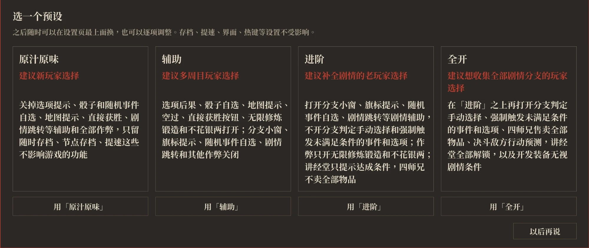

## 功能

下文帶「」的設定名與設定頁一致。各功能在哪一檔預設開啟，見上面的預設表。

### AI 陪玩（F3）

用自己的 API Key 接入大模型，問劇情和攻略，或者和遊戲裡的人物聊天。支援 DeepSeek、Kimi、通義千問、智譜 GLM、矽基流動、OpenRouter、OpenAI、Claude、Gemini、本機 Ollama，以及任何 OpenAI 相容介面。

- **攻略助手**：先查遊戲裡的劇情資料再回答，包括任務和觸發條件、劇本分岔和對白、各路線的好感和數值合計、結局和死亡、結緣路線、人物誌、場所事件、決鬥條件，以及目前進度和畫面上的選項。
- **女主角和大師兄**：九位可結緣的女主角和大師兄唐布衣用各自的口吻說話，立繪表情隨回答變化，對你的稱呼隨劇情變化。他們只知道你讀過的劇情。問到攻略時，回答後面另起一段攻略提示，也可以設成只聊天。
- **劇透程度**：分三檔，想知道什麼說什麼、只說目前和走過的劇情、只給方向提示。
- **回答方式**：分極速、標準、深度三檔。極速少查資料，回答更快、更粗略；深度換用更強的模型，回答前核對資料，更準，也更貴、更慢。
- **改數值和設定**：需要改數值、好感、心上人、旗標或咖啡伴侶的設定時，AI 先給出一張卡片，點確認後才改。
- **對話**：每位人設的對話存在本機，可以新開、切換、刪除，也能匯出到桌面；回答邊生成邊顯示。
- **主動陪玩**：選一位人設常駐遊戲畫面，在你做選擇、擲骰、打完一場、好感變化、限時劇情快到期時說一兩句，只評論和建議。發言頻率分安靜、正常、話多三檔，可以另外設定模型和每次啟動遊戲的 token 上限；形象能拖曳、縮小、暫停發言，點氣泡可以到 AI 陪玩頁追問。
- **自訂人設**：在資料夾裡放人設文字和圖片，就能加入自己的人設，在 AI 陪玩頁和主動陪玩裡都能選；也可以替換內建人設的圖片和人設文字。從「AI 設定」開啟資料夾，裡面有說明。
- **費用和隱私**：按服務商的價格計費，本 Mod 不收費。Key 和對話只發給你選的服務商；匯出的診斷裡不含 Key。


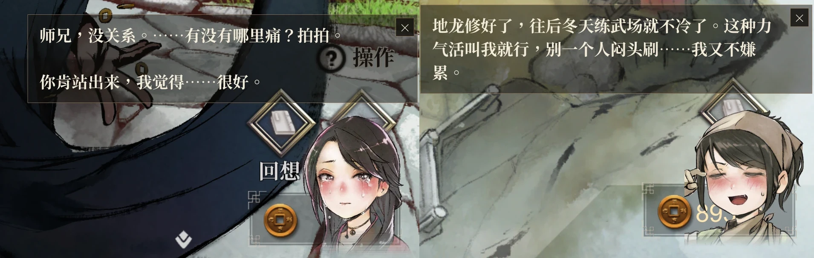

### 劇情回顧（Tab）

- **此刻**：目前這段劇情、所在地點和任務的情況。
  - 劇情：每個選項、轉盤的結果，分支的條件，選擇之後的劇情是否讀過。
  - 地點：當前地點的隨機事件、機率和沒看過的事件，可以直接選定下次觸發哪一個。
  - 任務：現在的主線、支線去哪裡觸發、還差什麼。
  - 戰鬥：打贏、打輸的後果和回合事件；戰役還顯示勝利條件和戰役事件。

  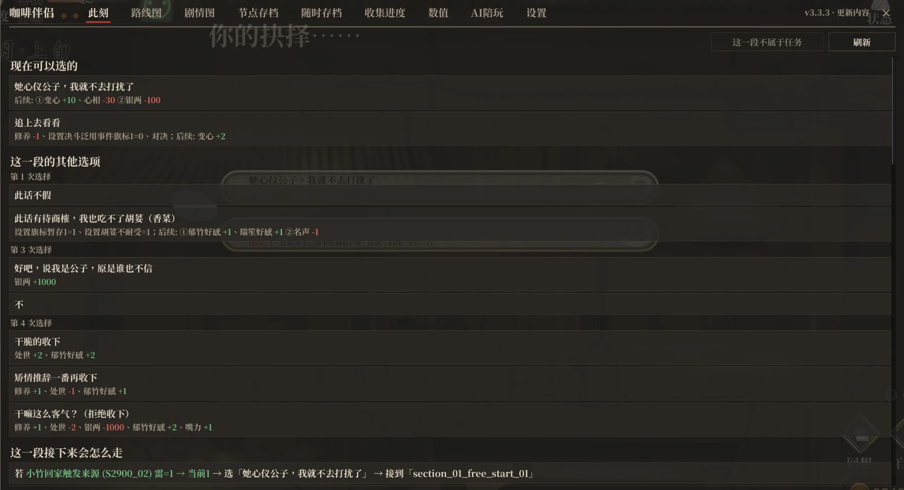

- **路線圖**：主線按時間排成一條橫線，支線掛在下面。
  - 岔路從主線上下分出，合流時回到主線，岔開的線上寫著觸發條件；並行的幾條路線各占一道，不交錯。
  - 打勾的是這一局走過的，紅色「今」字是目前所在的主線，下一站套金圈；點「回到現在」跳回目前這一站。
  - 點一站，顯示接下來去哪（時間、地點、條件）、觸發條件、站內的岔路和選項；選項預設摺疊，展開後顯示每個選項的條件和後果。支線寫明下一步和走完後接回哪一站。
  - 可以搜任務名、地點、台詞和旗標，也支援拼音首字母；搜到旗標時列出它在哪些劇情裡被改動、被判定。

  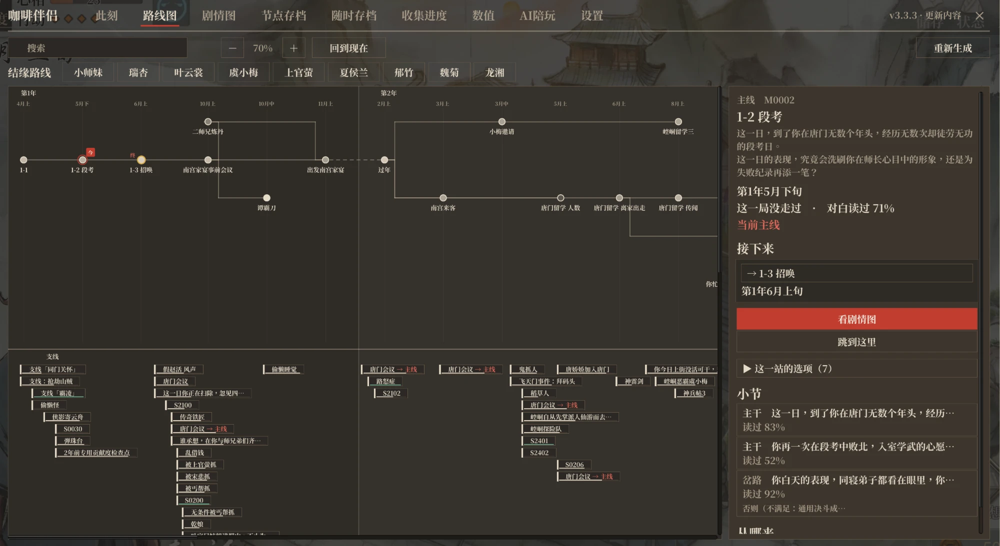

- **結緣路線**：在路線圖上選一位可結緣的人物，只亮出和她有關的劇情，列出每一步是否完成、在哪裡達成。

- **劇情圖**：單一任務的劇情流程圖。每個方塊是一段劇情，方塊裡一行一個去處（選項、擲骰、條件），從這一行連到它通向的段落；選了以後仍留在本段的選項也會列出。滑鼠停在一行上，顯示完整的條件和它改動的內容。崆峒日常、青城日常、江陵等地點的劇情也有劇情圖，只能查看。

  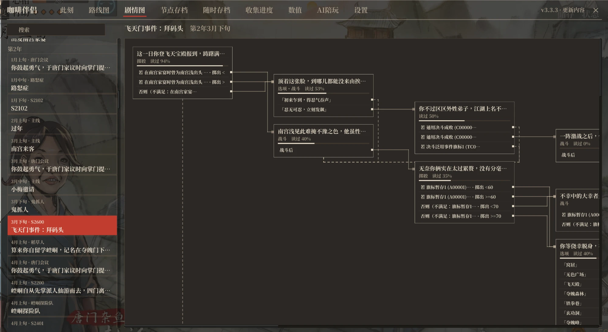

- **節點存檔**：遊戲在劇情存檔點和每旬開頭自動存檔時，同時記下進度；點「從這裡重玩」回到那裡，改走另一條路。各存檔互不干擾，不占手動存檔欄，隨 Steam 雲同步。

  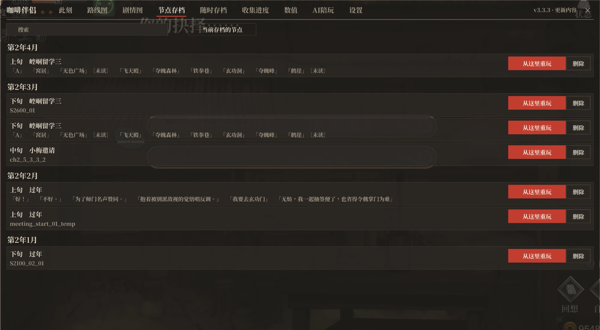

- **劇情跳轉**：在路線圖或劇情圖裡選取一段劇情，點「跳到這裡」直接從那一段開始玩，還沒走到的劇情也可以。
  - 跳轉前列出途中影響後續劇情的選擇，按所選補上中間的進度，也可以順便和一位女主角結緣。
  - 目標段落裡按條件分的岔路，預設走還有未讀對白的一支，跳過去後直接走這一支，不改數值。開啟「選分支時自動調整數值」後，先補上這一支的條件，補不上的再直接走。
  - 跳轉前自動存一個隨時存檔，可以隨時讀回。
  - 中間的劇情沒有實際玩過，偶爾會有對不上的地方，正常遊玩不建議使用。

  

- **收集進度**：全部周目的記錄，分劇情、女主線、結局、死亡、成就、結局 CG。
  - 劇情按各任務的對白已讀比例統計；結局、死亡、成就、結局 CG 標出圖鑑編號和達成情況，未完成的寫明去哪裡、怎麼走到。
  - 女主線按可結緣的每位角色統計她那條線的對白已讀比例和結局，展開按任務列出。
  - 每一項下面列出能通向它的任務，點任務名開啟它的劇情圖。
  - 「結局 CG」頁的「看片尾動畫」在劇情場景裡重播通關時的片尾字幕，按 Esc 結束。

  

### 劇情輔助

- **骰子手動選擇**：擲骰時點任意一條線路，直接選取那個結果。
- **選項結果**：對話選項、擲骰線路後面顯示選擇的後果。
  - 被鎖的選項顯示實際的解鎖條件，旁邊的「一鍵設定」把條件改到滿足。
  - 開啟「顯示未滿足條件的選項」後，條件不滿足就不出現的選項也會列出，標紅字「條件沒滿足」，滑鼠停在上面顯示條件；被鎖的選項條件改不到時，旁邊改為「強行解鎖」，不改旗標直接解開。
  - 「選項後果」可選總是顯示、滑鼠懸停時顯示、不顯示。

  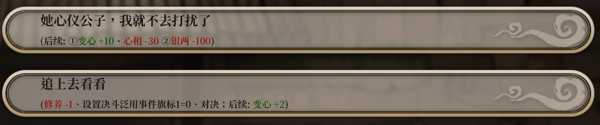

- **選項、骰子已讀標記**：在對話選項、擲骰線路後面標出後續對白的閱讀情況（沒看過、看過一半、看過）。
- **隨機事件自選**：工作、閒逛等抽隨機事件時先暫停，列出可觸發的事件、機率和帶來的變化，選一個直接觸發，也可以按原機率抽。
  - 按條件區分的變化寫明條件；沒看過的事件標「沒看過」。
  - 條件裡帶亂數的分支也可以選走哪一條。
  - 每個事件、每條路可以設「總是」「不出」，設定會記住，關掉自選後仍然生效。
  - 開啟「強制觸發未滿足條件的事件」後，出現條件未滿足的事件也列在下面並寫明條件，點選後無視條件直接觸發，不改旗標。

  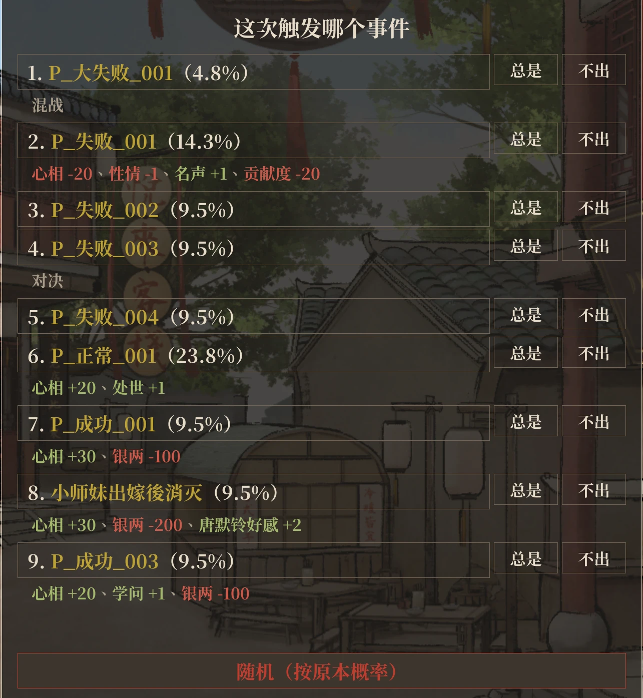

- **分支判定手動選擇**：劇情走到按條件分支的判定時，如果換一支能看到未讀對白或接到別的劇情，就先暫停，列出每一支的條件、目前的值和對白閱讀情況，選哪支走哪支。
  - 預設不改數值，只是這一次直接走過去。開啟「選分支時自動調整數值」後，先把屬性、好感、旗標改到正好滿足這一支，改動會保留；改不了的再直接走。
  - 只有一支能走、換一支也沒有新內容時不暫停。開啟「已讀分支也暫停」後，換一支有對白就暫停，讀過的也算。
  - 彈出時停止快進。
- **地圖建築事件提示**：養成地圖上滑鼠停在建築上，列出這裡的主線、支線（能否觸發、條件）和隨機事件的機率；有可觸發且沒走過的任務的建築會一直亮著。
  - 開啟「地圖提示僅列可觸發事件」後，只列現在進去就會觸發的，其餘只寫個數。
  - 進入建築後，滑鼠停在挑柴、修煉等選項上，列出這一項會抽到的隨機事件、機率和沒看過的事件；外出清單裡的移動、行商同樣適用。
- **限時劇情提醒**：條件已滿足但還沒觸發的劇情，離觸發期限不到 3 旬時，在養成地圖左上角列出還剩幾旬、截止日期和觸發地點；「此刻」頁的任務也會標出。
- **備忘錄**（F10）：浮在遊戲畫面上的小窗，用來記「在某天之前把某一項做到多少」。
  - 從數值、好感、天賦、設施、物品、旗標，以及功法、鍛造、煉丹的層數和進度裡搜一個條件，設目標值和截止日期。
  - 視窗即時顯示目前的值、進度和剩餘旬數；達成、回落、臨近截止、過期時在視窗頂部提示。
  - 視窗可以拖曳、縮放、收起。
- **物品說明顯示用途**（可能劇透任務名）：背包和商店的物品說明後面列出使用效果，以及哪些劇情會判定或收走它。
- **顯示分支判斷**（可能劇透）：分支判定時列出各分支的條件，滿足為綠、不滿足為紅，可選螢幕左側小窗或螢幕上方提示。

  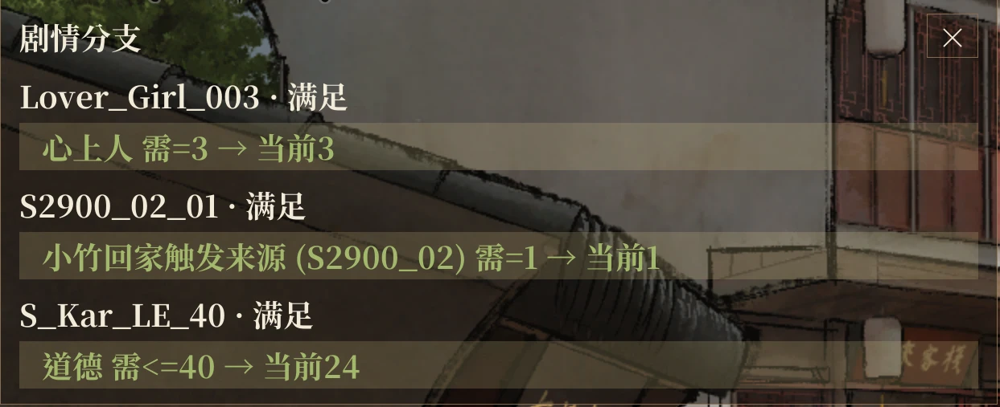

- **顯示旗標變化**（可能劇透）：劇情改動旗標時在螢幕上方提示，停留秒數和文字大小可調。
- **判定記錄**：劇情經過的判定、條件和當時的值記進回想（對話記錄）。
- **隱藏介面看 CG**：劇情裡按右鍵，只留背景、CG 和立繪；再按右鍵、點左鍵或按其他鍵恢復。

### 存檔

- **隨時存檔**：劇情的台詞、選項、擲骰時和養成介面都能存，不占原版存檔欄；戰鬥中不能存。
  - F5 存新檔，F7 讀最近的，F6 開啟清單。
  - 清單裡可以寫備註、看存檔時的對白，按存檔欄位、儲存時間或遊戲日期分組，也可以篩選、整組刪除。
  - 預設不限數量，可以在設定裡設上限。
  - 讀取時遮住快進的畫面，顯示進度並靜音。

  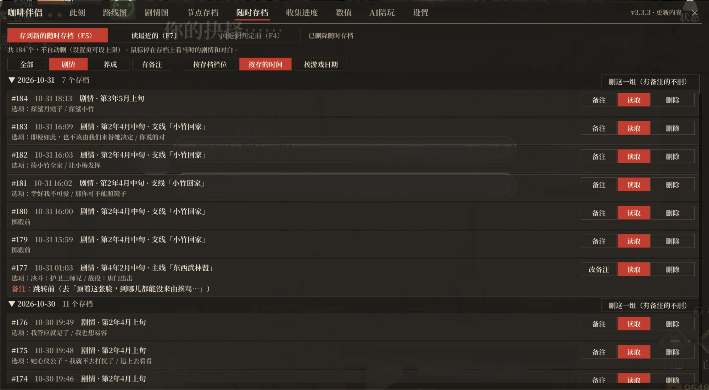

- **回退到判定前**（F4）：劇情遇到判定和分支選擇框時自動暫時存檔，按 F4 回到前一句重新判定、重新選。
- **新版存檔、讀檔介面**：可換回原版。
  - 清單帶心上人頭像、日期和備註；詳情欄顯示心上人立繪（已結緣的存檔換成害羞的表情）和讀檔後的頭幾句對白。
  - 手動、自動存檔分兩頁；開啟時自動選取上次儲存的存檔。
  - 讀檔頁右上角可以切換按欄位排，或最近儲存的排在前面；按最近儲存排時，存檔頁最上面先放一個空欄位。

  

- **更多欄位**：手動存檔 100 個（原版 20 個），傳奇欄位 5 頁（原版 1 頁 12 個），三類自動存檔各多保留 5 個舊檔；數量都可以在設定裡改。
- **存檔備註**：存檔介面裡選取手動存檔後按 F8 寫備註。備註隨 Steam 雲存檔同步，可以自動匯入 LOM_SaveSlotExpander 和 LOM_SaveSlotMemo 的備註。

### 養成

- **行動點**：正常 / 不消耗 / 每旬 N 點。
  > ⚠️ 後兩種可能讓部分劇情不觸發或提前觸發，甚至卡掉關鍵主線，請謹慎使用、多存檔。
- **無限修煉、鍛造、煉丹**：修煉、鍛造、煉丹不消耗次數和點數；「鍛造、煉丹不花銀兩」是單獨的開關。
- **突破屬性上限**：原本最高 100 的屬性，上限改為 9999。
- **開發裝備無視劇情條件**：鍛冶場、煉丹房開發新裝備、新藥時不看劇情條件，等級和門派規模的要求不變。
- **開發項目直接更換**：鍛冶場、煉丹房的開發介面顯示同類的其他分支，目前項目的等級和門派規模達到要求時可以直接更換，不用先退回預設項目。
- **彈珠固定總分**：離開彈珠小遊戲時，把總分改成設定的值。
- **四師兄售賣全部物品**：四師兄的商店賣全部書籍、雜物和特殊物品（《證類本草》除外）。
- **空過**：養成介面、留學地圖按 ESC，選單裡的「空過」消耗 1 次行動，不觸發事件；也可以在「熱鍵」組裡給它綁一個鍵。

### 戰鬥

- **決鬥敵人增強**：開戰時按主角六項屬性總和提高敵人的血量和屬性，強敵仍明顯強於普通敵人；敵人還會根據雙方的氣、血量和主角連續使用的招式調整出招。
- **決鬥敵方行動預測**：顯示敵方本回合預選的招式，視窗可以拖曳、縮放。
- **戰鬥失敗死亡提示**（會劇透）：這場戰鬥輸了會走到生死簿裡的死亡時，戰鬥全程在畫面上方顯示死亡名稱和生死簿收錄情況；輸了之後還要看其他條件的顯示「可能會死」；選項觸發的死亡不提示。
- **戰鬥回合事件提示**（會劇透）：決鬥到某個回合會結束戰鬥或改動旗標時，在畫面上方顯示下一個這樣的回合。
- **戰役手感優化**：
  - 修復硬直後方向鍵失靈。
  - 普通攻擊自動朝向最近的敵人，判定範圍擴大，主角腳下顯示攻擊範圍。
  - 平射暗器自動瞄準最近的敵人，蓄力拋射不再落空。
  - 主角絕招「奮力一擊」和掉落物拾取的範圍擴大。
  - 主角不再被我方的暗器、陷阱和毒霧誤傷。
- **戰役助戰選擇**：開戰面板的絕招清單加入好感度達到 40 的同伴，不限於劇情指定的同伴。
- **直接獲勝**：決鬥、戰役中按 ESC，選單裡有「直接獲勝」。
- **技能表完整顯示**：戰鬥時我方技能清單過長會自動分列。
- **戰鬥作弊**：「決鬥我方無敵」「決鬥敵方不受傷」「戰役我方不受傷」「戰役絕招無冷卻」四個開關，各檔預設都不開啟。

### 數值面板（F9）

角色數值、武功、門派、好感（所有人）、天賦、功法和鍛造煉丹點數、設施、書籍、物品、旗標都在一頁，每行可以加減或直接設定；可以按名字、編號、說明或拼音首字母搜尋。

- **書籍、物品**：直接改數量，和在商店買到一樣會推進相關任務。滑鼠停在武學書名上，列出每一層練成時加的屬性，已練成的打勾。
- **數值**：可以調到秘笈等加成以下，也可以調成負數，之後劇情加減、讀檔都保留。
- **心上人和稱號**：心上人顯示名字；心相、四種性格（性情、處世、修養、道德）、陰陽在數值後面顯示目前稱號。稱號可以從全部稱號裡更換，也可以自訂。
- **鎖**：心相、四種性格、陰陽、銀兩、貢獻度各有一把鎖，鎖上後劇情和選項都改不動它，重啟、換存檔後仍然鎖著。
- **旗標**：一千多面，分門派好感、人物、六道、劇情等幾類。
- **反查**：點旗標、書籍、物品的名字，列出它在哪些劇情裡被改動、被判定；點好感的人名，列出被判定的地方。都能跳到劇情圖。
- **數值預設**：在數值頁改過的項會被記下，點「數值預設」存成一個預設；換存檔或開新檔後點「套用」，一次把這些項設成儲存的值，沒改過的不動。

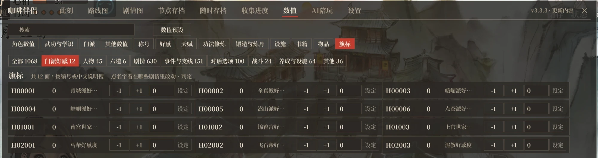

隨意改動數值、旗標可能讓劇情出錯，改之前先存檔。

### 提速

- **遊戲倍速**：1x / 2x / 3x / 5x。戰役和自動播放的對白保持原速；開啟「倍速作用於戰役」後戰役也加速。
- **一鍵快進**（F2）：劇情裡按一下，持續跳過讀過的對話，再按一下停止；遇到沒讀過的對話自動停下。
- **流程提速**：切場景、讀檔、快進更快，數值變化後的停頓縮短，決鬥回合之間不再等待。
- **啟動加速**：標題畫面的開場動畫加快；安裝器可以設成跳過開頭 Logo。

### 標題畫面

標題畫面增加「練功塔」「鑑賞」兩個按鈕。

- **練功塔**：遊玩試玩版的練功塔模式，可以觸發生死簿裡只有這個模式才有的死亡。
- **鑑賞**：分 CG、立繪、動圖、決鬥、音樂五頁，支援手把。
  - CG：看過的才顯示，場景圖全部開放；頁面上的開關可以顯示未解鎖的內容。
  - 立繪：選背景、擺放角色、切換差分，可以隱藏介面後截圖。
  - 動圖：播放角色戰鬥動作和特效的逐格動畫，可以匯出透明背景 GIF。
  - 決鬥：決鬥裡每個角色的戰鬥立繪，分正常、攻擊、受擊、防禦，可以縮放、拖曳，匯出透明背景 PNG。
  - 音樂：官方原聲帶全部 39 首，可以暫停、看播放進度。
- **標題畫面人物**：可以指定顯示哪一位，也可以全部顯示或不顯示。

### 介面和其他

- **介面**：視窗配色可選淺色、深色、跟隨系統；字型可選思源宋體或微軟雅黑；咖啡伴侶視窗、小窗、提示框的不透明度分別可調；遊戲文字和對白文字可以放大。
- **手把**：咖啡伴侶視窗全程可以用手把操作（L3 開關，左搖桿移動，A 點擊，LB / RB 切頁）；骰子手動選擇、空過、隨機事件自選也支援。
- **多語言**：介面隨遊戲語言顯示簡體、繁體、韓語；裝了[日語補丁](https://dlaqe2334.github.io/LOM-JPMOD/)時顯示日語，裝了英文補丁時顯示英語；也可以在設定頁手動選擇。
- **講經堂**：滑鼠停在汗青書、生死簿各項上顯示達成條件，也可以設成全部顯示為已解鎖。
- **匯出傳奇**：「狀態 → 傳奇」裡可以隨時把這一局的傳奇匯出成 txt。
- **背景繼續執行**：切到別的視窗時遊戲不暫停。
- **匯出診斷**：遊戲 ESC →「環境設定」→「匯出診斷」，把記錄和設定打包到桌面（不含存檔）；安裝器裡也有。
- **衝突檢測**：裝了會衝突的舊 Mod 時，在設定頁最上面提示；只是改了同一處、可以共存的不提示。和別的 Mod 快速鍵衝突時，自動讓出本 Mod 的按鍵。
- **更新提示**：視窗右上角可以查看每版的更新內容，有新版時紅字提示。

## 常見問題

**遇到 bug 怎麼辦？** 先重新執行一次安裝器，確認是最新版。還有問題就用「匯出診斷」，把桌面上的壓縮包發到 [QQ 群](https://qm.qq.com/q/22cO11mHBq)或 [Issues](https://github.com/kevinnie2003/LOMAssistant/issues)，並說明問題是怎麼出現的。

**裝了沒反應？** 從系統匣完全退出 Steam 再開啟遊戲。還不行就用安裝器裡的「匯出診斷」。

**遊戲放在中文路徑下？** 路徑裡有中文等非英文字元時 BepInEx 會載入失敗。把遊戲資料夾移到只有英文、數字的路徑下（Steam 收藏庫裡右鍵《活俠傳》→ 內容 → 已安裝檔案 → 移動安裝資料夾），再執行一次安裝器。

**選項結果不顯示、骰子不能自選？** 和舊版骰子大師、多功能 Mod 衝突。安裝器會自動處理；手動安裝請刪掉 `BepInEx\plugins` 裡的舊 Mod。

**能和其他 Mod 一起用嗎？** 能，功能不衝突的 Mod 可以一起裝。快速鍵衝突時本 Mod 自動讓出，可以在設定頁「熱鍵」組裡另綁。別的 Mod 如果自帶一份 BepInEx，裝完後重新執行一次本 Mod 的安裝器。用 Binarizer 載入的劇情 Mod 也能一起用：劇情圖、鑑賞讀取 Mod 的劇本，隨時存檔能在 Mod 劇本裡存讀；Mod 寫在腳本裡的判斷不顯示，裝上 Mod 後，走過被改動劇本的舊隨時存檔無法讀取。

**Linux / Steam Deck？** 手動安裝後，在 Steam 啟動選項裡加 `WINEDLLOVERRIDES="winhttp=n,b" %command%`。

## 開發

需要 .NET 8 SDK 和裝好本 Mod 的遊戲資料夾（編譯時引用遊戲和 BepInEx 的程式集，倉庫裡沒有遊戲檔案）。

```bash
GAME="D:/Steam/steamapps/common/LegendOfMortal" DOTNET=/path/to/dotnet ./build.sh
```

```bash
DOTNET=/path/to/dotnet ./Installer/build-installer.sh
```

第一條編譯 Mod 並裝進遊戲資料夾，第二條編譯一鍵安裝器。

| 目錄 | 內容 |
|---|---|
| `LOMAssistant/` | 插件入口、記錄、診斷、選項提示等 |
| `LOMAssistant.Config/` | 設定項 |
| `LOMAssistant.Features.*` | 各功能（`Extras` 是本項目新增的，`AnytimeSave` 是隨時存檔） |
| `Installer/` | 一鍵安裝器 |
| `tools/anytime-contract/` | 遊戲更新後重新生成隨時存檔的相容契約 |
| `tools/bepinex-patch/` | 給打包的 BepInEx 打補丁：修復遊戲裝在中文路徑下 BepInEx 啟動失敗 |

## 授權條款

[MIT](LICENSE)

## 程式碼簽章政策

Free code signing provided by [SignPath.io](https://about.signpath.io/), certificate by [SignPath Foundation](https://signpath.org/).

安裝器（`咖啡伴侣安装器 Installer.exe`）由 GitHub Actions 從本倉庫的原始碼建置後簽章，每次簽章都由維護者手動批准。

- 作者與審核者：[kevinnie2003](https://github.com/kevinnie2003)，其他人提交的 PR 由作者審核後合併
- 簽章批准者：[kevinnie2003](https://github.com/kevinnie2003)

**隱私**：除了下面這些由使用者開啟或要求的情況，本程式不會向其他連網系統傳輸任何資訊。

- 安裝器開啟時從 GitHub 讀取最新版本與更新內容，按安裝時下載新版壓縮檔。勾選「不連線檢查更新，只裝壓縮包自帶的版本」後不連網。
- Mod 進入遊戲後從 GitHub 讀取最新版本號。關閉設定「檢查新版本」後不連網。
- AI 陪玩在玩家提問時，把問題和相關的遊戲資訊傳給玩家自己設定的 AI 服務商；玩家開啟「主動陪玩」後，每次發言前把最近的對白和事件傳給同一服務商。

## 致謝

本專案不是從零開發的，功能思路和部分程式碼來自以下作者：

- **[活俠傳助手](https://mod.3dmgame.com/mod/256420)**：愛死（3DM：wowowo4567）。本專案的基礎，源碼由其發佈的插件反編譯而來後再修改。它又整合自 [骰子大師](https://mod.3dmgame.com/mod/210536)（Gmhaxx）、[多功能 Mod](https://mod.3dmgame.com/mod/210629)（Jim97）、[任意位置存檔](https://mod.3dmgame.com/mod/210679)（NothingNullNull）。
- **部分功能思路**：參考 [趙活系統](https://github.com/Toufff/zhaohuo-system)（Toufff，MIT 許可）。
- **AI 陪玩**：思路參考 [江湖夜話](https://github.com/Cpjjason/jianghu-yehua)（Cpjjason），它也是《活俠傳》的 AI Mod，能和遊戲裡的人物私下閒談，人物會送東西、指點武功、記得聊過的事（[B 站介紹影片](https://www.bilibili.com/video/BV1s2nC6pE83/)）；部分性格和小習慣參考了類腦社群夏呆呆的同人角色卡《活俠傳》。
- 感謝 [lxsb222-spec](https://github.com/lxsb222-spec)（愛死）、[blakceyes](https://github.com/blakceyes)、[NEXTAltair](https://github.com/NEXTAltair)、[pluvivanto](https://github.com/pluvivanto)、[lockpick](https://github.com/lockpick)、[F1-ZX](https://github.com/F1-ZX) 提交的 PR，以及 [mahosalieri85-a11y](https://github.com/mahosalieri85-a11y)、[iampigcheng](https://github.com/iampigcheng) 提交的 issue。
- 下載包附帶的 [BepInEx](https://github.com/BepInEx/BepInEx)、[UnityDoorstop](https://github.com/NeighTools/UnityDoorstop)、[Newtonsoft.Json](https://github.com/JamesNK/Newtonsoft.Json) 按各自的許可證分發。
